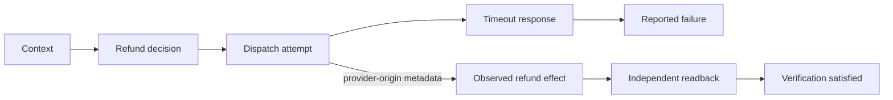

# Evidence core semantics

The version 2 core and public trace schema `1.0` are separate versioned
interfaces. Core imports and offline examples have no required runtime
dependencies or provider credentials. See [the stable API](stable-api.md),
[application integration](application-integration.md) and
[graph witness semantics](graph-witnesses.md) for the complete contract.

## Records and trust

An `Action` identifies one logical operation. A `ToolResponse` identifies an execution attempt. An externally observed `effect_id` identifies a durable simulated provider operation. Reusing a logical action or an idempotency key does not imply reusing an execution attempt.

`AgentAssessment` records the agent's reported outcome assessment, before verifier evidence is revealed. It is not an internal belief measurement. `Observation` carries source, scope, completeness and a snapshot watermark. `VerificationResult` contains evidence for satisfied, violated and unknown conclusions, including its reason and independent origin status.

The source and watermark declarations are trusted adapter inputs. Structural JSON validation does not authenticate a provider, certify its consistency guarantee, or prove that an imported verifier receipt is honest. Real integrations will need provider-specific evidence and trust assumptions.

Frozen, keyword-only dataclasses copy input JSON payloads into read-only containers (`FrozenDict`, `FrozenList`); a captured payload cannot be changed, and `thaw()` gives an editable copy. A trace can hold several actions; responses, assessments and verifications name the action they concern. Export validates strict JSON, including finite numbers and unique record identities. Import rejects unknown record fields and incompatible schema versions.

## Initial refund predicate

The built-in predicate is `refund_processed`. Its expected fields are `payment_id`, `amount_minor` and `currency`. It uses a fixed interpreter, never Python `eval`. Money is a positive integer in the currency's minor unit; INR 5,000 is `500000` paise.

An eligible witness commits between action registration and the deadline, and remains processed through the deadline plus stability interval. For a fixed `exact_count`, that count must also remain stable throughout the interval. A late or transient duplicate can violate this contract even if later compensated. `exact_count=None` requires at least one eligible surviving witness; `exact_count=0` explicitly requests no matching effects.

An exhaustive snapshot must cover the full horizon to make either a positive or negative final determination. A stale watermark, incomplete query, unavailable source, wrong scope, or malformed record gives `unknown`. A missing refund before final visibility is never converted into failure. A later observation can resolve an earlier unknown; both are retained.

Effect origin is a separate field:

- `confirmed`: matching logical-operation metadata links at least one relevant effect to the agent's action, without conflicting actor metadata.
- `other_actor`: the observed relevant effects have known different actors and no link to the current action.
- `unknown`: origin metadata is missing, ambiguous or conflicting.

Confirmed origin is evidence of operation identity, not counterfactual necessity. The desired state can be satisfied by another actor. In that case, or when origin is unknown, a reported failure is not labeled incorrect merely because a refund exists.

The current explanation compares success/failure assessments with the declared contract. Exact-count, parameter and temporal violations may differ from an individual provider operation's acknowledgement. Diagnoses should be read with their contract and evidence, not as claims to know the agent's hidden reasoning.

## Evidence graph

Temporal and declared dependency edges describe captured history. Response edges use a unique, nonempty attempt identity. Effect edges also require consistent dispatch and readback action identities and actors; conflicting metadata cannot create a link. Ambiguous attempts are left unjoined. Event identities that collide with generated evidence-node identities are rejected rather than overwriting a node. Observed effects come from readback, never the simulator's gold log.

Only an explicitly supplied replay estimate adds `ESTIMATED_INFLUENCE` edges. An action-target estimate links to the initial decision that produced the action intent, not a later retry. A consequence-target estimate links to the outcome contract. Both concern the declared replay experiment, not actual-cause proof for one execution.

## Isolated replay

`RefundReplayRunner` declares mode `isolated_simulation` and starts a fresh world for each call. Interventions neutralize or replace one declared context field before its affected descendants run. Arbitrary history deletion is unsupported. The outcome contract stays fixed even if the intervention prevents the action from being selected.

Paired seeds key separate selection and retry random streams. Factual samples can be reused across candidate interventions because each call resets the same initial conditions. A runner must provide independent draws across seeds; reproducibility alone does not guarantee statistical independence in arbitrary adapters.

`leave_one_out` returns signed differences between original and intervened rates. It supports `action` and `consequence` targets. A single unknown consequence pair refuses the estimate, rather than counting unknown as failure or silently dropping it. Intervals subtract Bonferroni-adjusted marginal Wilson bounds. Their individual-estimate coverage is approximate and conservative; they do not supply simultaneous coverage across all factors, nor generalization to new task templates.

## Simulator boundary

The simulator implements ten execution conditions, including clean, pre-dispatch failure, timeouts before/after commit, false success, delayed readback, partial effects, duplicate effects, wrong parameters and wrong targets. Synthetic compensation and external-actor operations are separate fixture controls.

Refund balances are finite. Stable idempotency keys prevent repeated effects and reject a changed payload. Unsafe duplicate examples use two partial refunds that both fit within the original payment.

Every provider attempt has an evaluator-only record of the injected fault, cache handling and committed effects. The explainer receives the portable trace and readback observations. It never receives those evaluator records. Fixture fault labels are omitted from trace identities. Demo labels and configuration files belong to the evaluation material, and must not be passed to an attribution model.

The fixture is deterministic apart from explicitly configured programmatic random policy choices. No LLM or real payment provider is evaluated in this build. Snapshot/fork tests establish isolation for this simulator; they do not establish production transactional guarantees.
