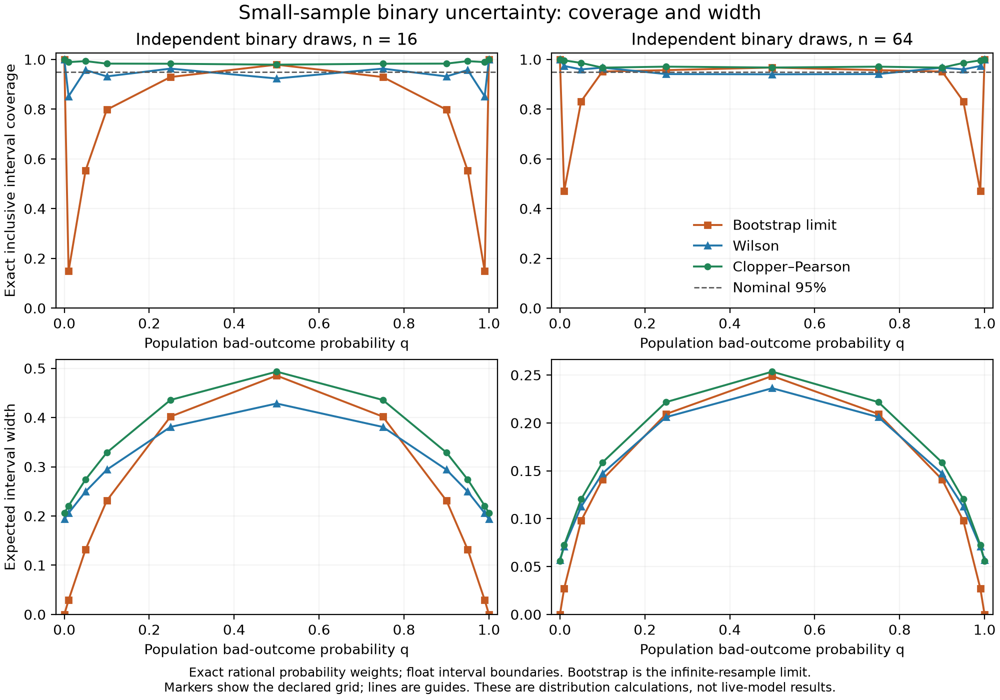

# Interval comparison findings

This exploratory synthetic follow-up retained 384 planned trials (32 per case),
66,048 planned replay branches and 87,054 actual scripted policy calls. Interval
variants used the same raw draws, points, seeds, budgets and refusals, with zero
extra calls. Collection source: `0d8ec0baee84ca0d33f52739456d54d6f61a27ad`.
The original 1,280-trial bootstrap/normal probe remains unchanged.

## Mathematical comparison and numerical validation

Every success count was enumerated for `n=8,16,32,64` and eleven predeclared
probabilities from zero to one. Probability weights are exact rational values;
interval boundaries use floating-point arithmetic. Minimum coverage on this
grid was 7.72% for the limiting empirical percentile bootstrap, 85.15% for
Wilson and 96.68% for Clopper–Pearson. The bootstrap grid describes its
infinite-resample limit; actual seeded 2,000-resample intervals are separately
measured in the replay comparison.

The independent SciPy check covered 1,290 binomial cases and 1,290 endpoint
differences, including confidence `0.9999999999999999`. Maximum absolute
binomial endpoint disagreement was `2.6645352591003757e-14`. See
`audits/numerical.json`. SciPy is an audit dependency; the framework retains
zero required runtime dependencies.

Clopper–Pearson is conservative under the independent binomial model; the
finite grid validates this implementation at its declared settings, rather
than proving live-model coverage. [NIST's interval definitions](https://www.itl.nist.gov/div898/handbook/prc/section2/prc241.htm).

## Fresh replay coverage and power tradeoff

At the timeout position for the protective-stop consequence target:

| Retry probability | Bootstrap covered | Exact binomial covered | Normal Shapley covered | Hoeffding Shapley covered |
| --- | --- | --- | --- | --- |
| .1 | 26/32 | 31/32 | 23/32 | 32/32 |
| .5 | 31/32 | 32/32 | 32/32 | 32/32 |
| .9 | 31/32 | 32/32 | 29/32 | 32/32 |

All other cases remain in `summary.json`, including exact binomial coverage
30/32 for the retry-pivot `.5` case. A finite observed proportion can fall
below nominal coverage even for a conservative method. Thirty-two repetitions
are an integration comparison, not an empirical calibration guarantee.

The conservative pair bounds are substantially wider. At `q=.1`, mean width
was about `.180` for normal versus `1.358` for Hoeffding. At `q=.5`, the widths
were about `.344` versus `1.184`. Hoeffding identified the negative reference
sign in 0/32 repetitions for both weaker settings, and 32/32 at `q=.9`. These
results expose the loss of detection strength; wider bounds are not a claim of
uniformly better attribution. No interval is adjusted for multiple decisions
or targets. The state and action-linked targets share evidence and are not
independent replications.

## Evidence and game restrictions remain

Unknown provenance, stale readback, failed/unstarted draws and exhausted
budgets retain the same refusal rules. The strict three-position retry game
still lacks a numeric population reference at interior retry probabilities.
At `q=.9`, six sampled Shapley vectors were available, but all remained
ineligible for numerical reference scoring. Conservative bounds cannot make
that intervention game defined or repair missing evidence.

The saved independent audit rederived raw mechanisms, labels, seeds, calls,
bootstrap/normal calculations and new bounds, then checked complete aggregate
inventories, every variant's locus counts and the artifact manifest. It passed
3,283,523 assertions at the initial derived-artifact inventory. Twenty
targeted corruptions of inventories, locus results and manifests were rejected
in separate smoke copies; see `audits/negative-checks.json`. The audit does
not establish authentic provider evidence or live-model independence.

## Engineering default decision

Alpha `0.1.0a2` uses Clopper–Pearson for contrastive binary effects, Hoeffding
for signed Shapley pair means and two exact binomial marginals with a split
failure allowance for endpoint differences. This choice avoids certainty from
homogeneous observations while retaining the original points and refusal
policy. Bootstrap/normal remain explicit comparators, and `calibrate-attribution`
continues to declare its original collection methods. Users must budget for
the wider pair bounds and assess sampling assumptions before making inference.

The next replay extension defines a separate on-reach game for variable-length
episodes. It does not change the strict game's retained results or eligibility.
Live held-out evaluation, matched baselines, joint context/fault attribution and
paper-level superiority remain separate requirements.
