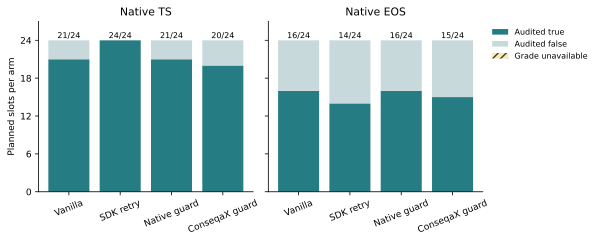
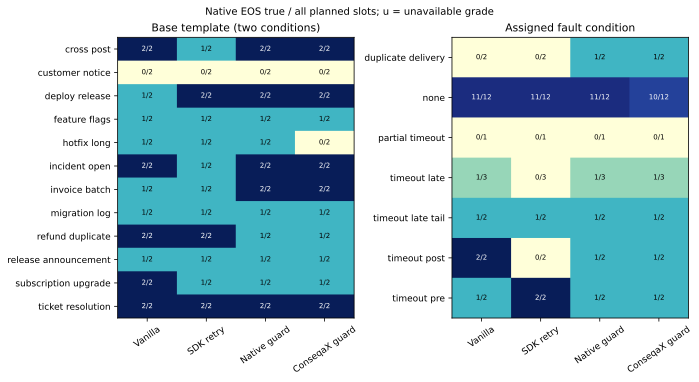
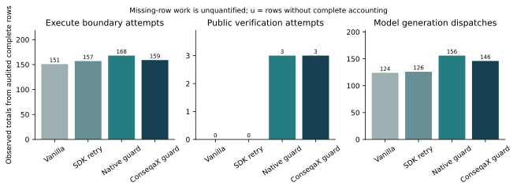

# ConseqaX: An Evidence Protocol for Recovering Ambiguous Agent Actions

Devrajsinh Jhala

Independent Researcher

Generic IEEE manuscript reporting controlled and externally authored simulator studies. No venue or acceptance is asserted.

## Abstract

A timed-out tool call can leave an agent uncertain whether an operation failed or will commit later. ConseqaX separates state, action-origin and unknown conclusions through explicit contracts and readback witnesses. Study A retains 15,360 SQLite worlds from 24 authored cases: readback safely recovers 14/24 versus 8/24 for response-driven retry, matching a strong reference. Repeated seeds add no recorded-metric diversity; polling adds no coverage and detection does not repair all harmful effects. Study B retains 960 worlds: polling raises correct-state yield from 3/192 to 81/192 at 741 versus 192 reads, with identical physical outcomes. The externally authored LIMBO study covers 12 base instances, 24 task/fault conditions and four arms. The interrupted original retains 6/96 audited grades. A separately declared follow-up, after partial-data exposure, retains another 96 planned slots on the same instances; cohorts are not pooled. Replay establishes 96/96 follow-up grades, including 3 native error returns after settlement. All-planned results are Vanilla: TS 21/24, EOS 16/24; SDK retry: TS 24/24, EOS 14/24; Native guard: TS 21/24, EOS 16/24; ConseqaX guard: TS 20/24, EOS 15/24. The package emits 3 audited receipts in 3/24 episodes, with complete accounting in 24/24. Receipt activation demonstrates integration rather than a new recovery algorithm. Missing grades remain unavailable. Native EOS has domain-specific accounting, not a universal exactly-once guarantee. Study A's packaging deviation remains disclosed. These finite simulator results establish neither task-population superiority nor independent service validation.

**Index terms:** agent systems, outcome verification, recovery, idempotency, evidence provenance, uncertainty

## 1. Introduction

An agent requests an inventory allocation, ticket, or published artifact. The
provider accepts the operation, but the acknowledgement times out. An immediate
retry may create a second record; stopping may leave the task unfinished. A
separate read can reveal an existing effect, yet even a fresh empty snapshot
cannot establish that the first request will never commit later. A reliable
recovery decision depends on the operation's identity, provider guarantees,
temporal target, and available evidence, rather than the response alone.

Three distinctions matter. First, a response describes a tool interaction,
whereas a readback supplies evidence about external state. Second, global task
satisfaction differs from an effect being linked to this agent's operation.
Another actor can complete the task; missing actor metadata need not imply an
external actor. Third, a hindsight-correct assertion can have been unsupported
when issued. A controller that guesses the eventual outcome correctly has not
thereby justified a retry or a completion claim.

These are established systems and verification concerns [1]–[6]. ConseqaX makes
them explicit in a reusable evidence protocol [7]. Its typed records bind
contracts, attempts, responses, observations, and verification receipts.
Readback distinct from the acknowledgement signal can support satisfied, violated, or unknown state, while
origin remains a separate conclusion. The protocol does not authenticate a
provider or manufacture request finality. Applications supply source semantics
and the policy connecting receipts to actions.

This paper centers that policy boundary. We compare response-driven same-key retry,
state-only readback, a separately implemented provenance-aware reference, a
package-backed single-final-read ablation, and package-backed bounded polling.
Controller actions change subsequent SQLite effects and observations. The experiment
asks whether the declared evidence policy changes safe recovery, final-report
correctness, or definite-report coverage at a measured read/wait cost, and when ordinary
provider idempotency removes the apparent advantage. The endpoints concern
executable contracts, retained effects, and final-report hindsight truth;
subjective explanation quality is outside the study.

The research questions are falsifiable. **Q1:** How does polling change safe recovery
relative to response-driven retry, together with own harmful effects and recovery
failures? **Q2:** Does the package-backed implementation agree with a same-information
reference using separate evidence arithmetic? **Q3:** What additional origin-report
coverage and correctness appear beyond state-only reporting? **Q4:** Does continued
polling change final-report correctness and coverage relative to one final read at its
additional resource cost? **Q5:** What abstention and definite-error tradeoffs remain
under incomplete public histories? Equal or worse recovery, incorrect conclusions,
unnecessary reads, or parity under shared provider guarantees can limit the proposed
benefit. **Q6:** Under native ambiguous-commit faults, how do all-planned task/effect outcomes, failures and actual work differ among vanilla dispatch, transparent retry, the supplied strong guard and its receipt-preserving SDK integration?

The contributions are an executable evidence protocol, a controlled evaluation of recovery/reporting boundaries and a native external fault-benchmark integration with audited first-attempt accounting. The controlled reference uses separate arithmetic but shares application transitions; its agreement supports conformance. The external SDK arm deliberately preserves an established strong guard, so it does not introduce a new recovery algorithm. Provenance changes only reporting in the controlled shared-transition comparison. The native experiment and actual results in Sections 6 and 7 retain 96 planned slots per cohort on the same 12 base instances, including the original interrupted cohort and the separately frozen follow-up. Neither repeated seeds nor repeated arms create independently sampled tasks.

## 2. Related Work and Positioning

Idempotence and eventual consistency are longstanding systems concerns [1], [2].
Verified Tool Calls separates acknowledgements from independently checked
effects and admits unknown postconditions [3]. Callability Is Not Operability
examines controlled interface ambiguity and terminal agent claims [4]. Agent-tool
anomaly work distinguishes runtime observations from external events [5]. LIMBO
grades committed-effect histories and studies late commits [6]. Consequently,
response/effect separation, effect ledgers, and the danger of ambiguous retries
are foundations and comparison requirements here, rather than priority claims.

PROV-DM represents entities, activities, agents, and responsibility [8]. ConseqaX
is neither a new general provenance model nor a PROV conformance implementation.
Its narrower boundary links operation identity, temporal contracts, individual
observation witnesses, and explicit unknown verdicts. A source-supported origin
link is not proof that the action was counterfactually necessary.

Causal Agent Replay (CAR) performs same-policy interventions with contrastive
suffix and permutation Shapley attribution [9]. Policy-Conditioned
Counterfactual Credit studies verified outcomes under declared interventions
and continuation policies [10]; CausalLoss-Fin jointly intervenes on decisions
and infrastructure messages [11]. Those questions differ from whether a live
recovery action is justified by its available evidence. Our earlier replay
adapter uses existing estimators. The present experiment requires neither
counterfactual writes nor a new attribution method.

AppWorld, ToolSandbox and tau-bench evaluate stateful agent interaction and world outcomes [12]–[14]. Earlier model-free transfer used maintained retail/airline tools and native DB evaluation [15], [16]; reference-action replay is not an autonomous score. Our external experiment uses LIMBO's authored tasks, native faults and unchanged grader [6], [20], retaining its supplied strong guard as a comparator. The receipt arm tests protocol integration under that same recovery law. The native grade and independently replayed effect history extend the controlled evaluation while remaining simulated evidence from one local quantized model.

The present contribution is therefore conditional: an executable evidence contract and
an auditable comparison of policy tradeoffs under declared capabilities. Its value must
come from the recovery behavior, final-report correctness, coverage, and cost actually
measured, rather than from attributing established distributed-systems guarantees to a
framework.

## 3. Evidence and Recovery Protocol

This section specifies the temporal record contract and application recovery law evaluated in controlled Studies A and B. The external LIMBO condition instead uses the benchmark's own guard and a custom current-public-report verifier; it does not apply this controller or the temporal RecordVerifier to native reports.

### 3.1 Objects and temporal targets

A logical action has stable identity and payload; each dispatch has a distinct
attempt identity. Captured records include the request, provider response,
reported assessment, separately captured observation, and resulting verification
receipt. Reported assessments are outputs, not measurements of hidden reasoning.
An observation states its source, scope, completeness, availability, observation
time, watermark, and effect history. The application declares which source and
clock are authoritative.

Let registration be $t_0$, the original deadline $D$, stability duration $W$, and
original horizon $H=D+W$. The original contract remains fixed. A separate recovery
deadline $R\geq H$ and safety horizon $S\geq R$ define later recovery in this study: its
matching candidates must commit by $R$ and persist through $S$, and its count is checked
throughout $[R,S]$. A later completion may satisfy recovery while violating the original
SLA. Neither a new read nor an explanatory receipt moves $D$.

For the exact-count record contract, a candidate matches the expected business
fields, commits within $[t_0,D]$, and persists through $H$. The declared count
must hold, including the maximum simultaneous matching count over $[D,H]$.
Historical removals and transient extras therefore matter; a current-row
snapshot alone is insufficient. Simultaneous commits and removals are evaluated
together, with boundary conventions fixed before collection.

The verifier concludes satisfied, violated, or unknown. A complete admitted
observation must cover the registered scope and history through $H$. Stale
watermarks, inadequate scope, unavailable reads, or malformed history retain
unknown. Source identity, completeness, timestamps, and provenance are trusted
adapter declarations. Schema checks and hashes establish structure and retained
bytes, not source authenticity or transactional guarantees.

### 3.2 State, origin, and support

Global state satisfaction does not require this agent to have produced the
effect. Action-linked satisfaction additionally requires qualifying target
evidence linked to the logical operation. A known global violation makes this
linked contract false even if an own matching record exists: a second effect
can invalidate an exactly-one task. Mere witness presence cannot replace the
whole contract.

A matching action identity with absent or matching actor metadata can support
linkage under the admitted provenance law. Explicitly different identities
exclude this operation; missing or conflicting linkage can remain unknown.
Provenance does not turn an externally satisfied state into a failure. Each
observation retains its own witnesses. A later record sharing an effect ID
cannot inherit an earlier observation's origin link while silently changing
payload, actor, or removal history.

Hindsight correctness and evidence support are distinct questions. The present evaluator
scores final state and action-linkage reports against full-ledger truth, with separate
definite-report and abstention counts. It does not independently label support at
issuance or score safe-to-retry assertions. Raw public histories and final claims are
retained for artifact inspection; a hindsight-correct guess alone does not
establish support. An origin abstention does not erase a definite state conclusion.
Conditional error among definite assessable reports and correct definite yield over all
planned worlds answer different questions.

### 3.3 Why historical absence cannot resolve a pending attempt

**Conditional retry boundary.** Suppose an operation times out without atomic
deduplication, terminal resolution, completed cancellation, or an enforceable
in-flight bound. Let $L<R$ be the last useful retry time. Two provider worlds
give identical admissible histories through $L$: the initial attempt never
commits in one and commits after $R$ but by $S$ in the other. A retry by $L$
achieves recovery by $R$; a later retry cannot. An extra effect is harmful even
if compensated, and no alternative operation achieves the target.

A deterministic policy takes the same decision in both histories. Retrying
creates a duplicate in the late-commit world; declining misses recovery in the
never-commit world. For a randomized policy, couple its randomness and let $p$
be its useful-retry probability. Duplicate risk in the second world is at
least $p$ and missed-recovery risk in the first at least $1-p$. Their sum is at
least one for this constructed pair. This elementary indistinguishability
argument states a known systems boundary [6], rather than a new impossibility
or a measured prevalence. Provider guarantees can break its assumptions.

### 3.4 Application safety gate and bounded reads

Every policy preserves the operation key and payload. When a public native
idempotency capability is admitted, the provider atomically reserves pending
and completed work for that key. All readback policies may use the same-key
exception to retry within the common cap before $D$. The response-driven arm
also benefits from the identical provider semantics; it is the ordinary
bounded idempotent-retry comparator in that stratum.

Without that capability, the readback policies permit another dispatch only
when every previous attempt has an admitted terminal-no-effect guarantee,
fresh complete trusted readback establishes no relevant effect through the
decision time, budget remains, and time is strictly before $D$. A newer
terminal response does not resolve an older ambiguous request. An empty
watermark proves only past absence; it supplies no terminal guarantee.
Resolution of the agent's attempts also cannot prevent another actor's future
write. Global race freedom would require additional provider semantics.

The package's generic retry advice is recorded, but this application gate
authorizes dispatches. Provisional predeadline verification has its own target
ending at the current time; it never replaces the fixed $D/H$ receipt.
Bounded polling uses externally scheduled callbacks rather than the public
blocking polling helper, allowing all arms to share admitted opportunities.
At exhaustion, insufficient evidence remains an abstention. No policy dispatches
after $D$; recovery at $R$ is a distinct evaluator outcome, not an extension of
the original dispatch window.

## 4. Frozen Closed-Loop Study

### 4.1 Corpus, separation, and execution

The schedule crosses 24 new cases, 128 timing seeds, and five policies:
15,360 planned worlds. Cases span 12 purposive families in three nonpayment
SQLite domains: inventory, tickets, and artifacts. Related cases share
mechanisms; identifiers and seeds do not create new families. Separate AI
agents authored controllers and cases. The controller author never inspected
the case file, and the lead integrator did not manually inspect case values
before freeze. This is procedural separation within an AI-assisted workflow,
without external human authorship or random task-population sampling.

Each world uses a fresh database. The frozen exogenous event schedule, timing
seed, provider law, source behavior, budgets, and read opportunities are paired
across policies. Actions create branch-specific effects, so later observation
contents can legitimately diverge. Matching means equal capabilities and
opportunities, not forcing one policy to consume another's realized evidence.
Readback is a separate application method that queries the same SQLite effect
ledger through the same connection after advancing the simulated world. Its
contents are distinct from the acknowledgement signal; it is not an independent
connection, source, or trust domain. Only the postcollection auditor opens
retained database snapshots read-only.

The public allowlist includes request/contract, identities, response history,
provider capability and terminal receipts, and scoped readback history.
Controllers receive no case/family/fault labels, hidden future events, evaluator
truth, or another policy's reports. They are deterministic application state
machines. The run requires no LLM, user simulator, remote provider, or paid API
call and supplies no autonomous-agent benchmark reward.

### 4.2 Five policies and the strong comparison

| Policy | Evidence interpretation | Recovery and reads |
| --- | --- | --- |
| `response_retry` | ACK/error proxies for state and action completion; unresolved timeout unknown. | Retry ambiguous timeouts with the same key within the cap and original deadline. |
| `readback_state` | Trusted complete history for global state; abstain on provenance when state holds. | Shared gate and bounded scheduled reads. |
| `reference` | Independent standard-library count/time and provenance arithmetic. | Same application state machine and read opportunities as polling. |
| `consequax_one_read` | Public 2.1.1 verification receipts plus explicit linkage uncertainty. | Gate-relevant predeadline queries; one final horizon-eligible query. |
| `consequax_poll` | Same public verification and linkage rule. | Shared gate with continued scheduled reads until known or exhausted. |

The single-read arm is not forced to spend its final query before $H$. It may
perform a predeadline gate query when terminal guarantees make retry relevant;
its first query at or after $H$ is its only final query. Polling can use later
opportunities to resolve lag, incompleteness, or unavailability. Equal maximum
budgets need not yield equal spend; early stopping and skipped queries are
policy outcomes.

The reference imports no package verifier. The controller author implemented its
evidence arithmetic separately, while sharing the declared application transition logic
with the polling comparison. Thus exact agreement is a conformance result, not a contest
between independently designed recovery algorithms or external implementations.
State-only and provenance-aware arms likewise do not test a provenance-caused action
benefit when transitions coincide. They test origin-report coverage and correctness
under the admitted provenance law.

### 4.3 Endpoints, costs, and finite-suite analysis

The primary all-slot endpoint is **operational safe recovery**: the global recovery
payload/count contract holds by $R$ and persists through $S$, with neither an own
duplicate nor an own unwanted effect committed through $S$. An own duplicate means more
cumulative own committed effects than the allowed logical-operation count, including
effects later removed. An own unwanted effect mismatches the expected business fields or
commits after $R$. These predicates do not certify the absence of every harmful external
activity; another actor's effects can still violate the global recovery count. Every
scheduled cell remains in the operational denominator, and failed or unstarted execution
cannot earn success. Failed cells' semantic state, origin, and harm outputs remain
unavailable rather than receiving fabricated violation labels; an incomplete collection
cannot yield a complete audited result. Own duplicate and unwanted events are mandatory
companions, including effects subsequently removed. If safety is unauditable, all-slot
harm lower/upper bounds must expose that uncertainty.

Retained truth records distinguish original $D/H$ satisfaction, operation-linked
satisfaction, and controller-created effects. The summary scores the final state and
action-linked reports for hindsight correctness, false success, definite coverage, and
abstention. Conditional error is wrong definite outputs divided by definite assessable
outputs; correct definite yield uses all planned worlds. A zero-claim error rate is
undefined. Semantic rates and resource means use observed completed cells with
unavailable counts shown; the primary operational score and claim yields retain planned
denominators. Evidence support at issuance is not a scored endpoint. External
completion does not establish successful execution by this controller.

For family $f$ and policy $m$, let $y_{fm}$ be mean operational safe recovery
over every scheduled case/seed cell in that family. The predeclared primary
contrast is

$$
\Delta = \frac{1}{12}\sum_{f=1}^{12}
  (y_{f,\mathrm{poll}}-y_{f,\mathrm{response}}).
$$

The full 12 paired differences accompany the equal-family mean and all-slot
cell totals. Secondary views compare polling with state-only and one-read;
reference agreement is implementation checking. Capability, domain, and fault
strata are descriptive. No population p-values, task-population confidence
intervals, equivalence, or noninferiority claims follow from these purposive
families. Timing-seed replication characterizes this fixed suite, not new
independent tasks. Any seed-law uncertainty must identify its own sampling
assumptions and cannot supply task-population inference.

The analysis retains actual dispatches, readbacks, wait decisions, and logical decision
time under shared ceilings, separating evaluator audit work. Accounting includes
unsuccessful requests and timeout dispatches. Provider terminal guarantees are response
fields; separate resolution, cancellation, and refused-request cost endpoints are not
implemented. A zero-success cost-per-success ratio is undefined. Host runtime is
separate from simulated logical time; one local collection does not establish intrinsic
production overhead, wall latency, or service charges.

### 4.4 Freeze and first-run integrity

The pinned 2.1.1 wheel runtime is bound to study source
`22e88498cff0e2afd1549803fb4d9645902e74b9` and protocol commit
`3d3dd4ca663d3e16c7cb1ead4c59c724af9bedd7`. Protocol SHA-256 is
`b5c6a06bf1d758678e4d9890aa66872d4036634e2a4a4fd89626bd710bbc5aaa`. The artifact binds
corpus, schedule, controllers, provider/evaluator law, analysis, Python executable
identity, and installed framework source/runtime before measured execution. It retains
first-run cells, failures, stop/abstain decisions, and deviations. Corrections after
exposure require a separate version; deterministic re-execution cannot replace the
original denominator or create new independent trials. Hashes identify bytes rather than
authenticating the source's semantic claims.

A packaging deviation is retained explicitly. All scheduled trials, database
snapshots, journal rows, and the summary were present when the session resumed,
but the original runner's terminal manifest and receipt were absent. Its exit
status and termination cause are unknown. A separate postcollection finalizer
preserved every existing byte, rechecked source/runtime/claims, and created only
the missing packaging files. It did not resume or rerun worlds or regenerate
the summary. The completion timestamp denotes packaging time. The unchanged
frozen auditor subsequently checked database lifecycles and recorded endpoints; neither this audit
nor retained claims prove absence of off-record execution or earlier tampering.

## 5. Recovery Results

### 5.1 Retained collection and effective diversity

All 15,360 scheduled worlds are retained: 3,072 planned and completed worlds per
policy, with zero execution failures. The unchanged [original-host semantic
auditor](../output/recovery-controller-audit-2026-10-20/audit-receipt.json) queried
every SQLite snapshot and recomputed the endpoint summary. The [portable
retained-artifact audit](../output/recovery-portable-audit-2026-10-20/portable-audit-receipt.json)
also passed and queried all 15,360 snapshots. The portable audit does not verify
the original host or live claims. Separate audit code does not supply independent
external replication; its author also authored the controllers.

The [prospective protocol](../output/recovery-controller-protocol-2026-10-20/protocol.json)
has SHA-256 `b5c6a06bf1d758678e4d9890aa66872d4036634e2a4a4fd89626bd710bbc5aaa`
and binds source `22e88498cff0e2afd1549803fb4d9645902e74b9`. Section 4.4's
packaging deviation remains part of this result. The [finalization record](../output/recovery-artifact-finalization-2026-10-20/finalization-record.json),
SHA-256 `26fabbec4c16af115ad367086efd247e0660af801f0290fe57fa4265a84440a0`,
records preservation of all retained bytes and creation only of the missing
terminal manifest and receipt, with no worlds rerun or summary regeneration.
The original exit status and termination cause remain unknown. Packaging time
is not a recovered original completion time, and retained artifacts cannot
prove absence of off-record execution or earlier tampering.

Across all 120 case–policy groups, none of the recorded endpoint or resource
metrics varied over the 128 seeds. Some exogenous timestamps varied, but the
repetitions added no endpoint diversity. The substantive challenge set therefore
remains **24 authored cases in 12 purposive families**, rather than 15,360
independent tasks. The [retained summary](../output/recovery-controller-study-2026-10-20/summary.json)
and [paired exports](../output/recovery-publication-figures-2026-10-20-v3/paired-contrasts.csv)
retain the exact finite-suite counts; no task-population inference follows.

### 5.2 Recovery, harms, and the strong comparison

Every readback policy achieved operational safe recovery in **1,792/3,072 worlds
(14/24 cases)**, compared with **1,024/3,072 (8/24)** for response-driven retry.
The predeclared equal-family primary difference was **+0.25**. Of the 12 family
contrasts, three were +1 and nine were zero. Differences against the separate
reference, state-only, and one-final-read policies were zero in every family.

The three positive families have specific explanations. In weather-supply and
translation-routing cases, response-driven timeout retries created an extra
non-idempotent effect; the readback policies dispatched once. In mobile-lab
cases, the first response explicitly terminated without an effect; readback
policies verified fresh absence and retried, while the response baseline's
declared error rule stopped. This third gain concerns that particular rule,
rather than superior deduplication. The equally informed classical reference
achieved the same recovery as the package.

Every policy below has 3,072 planned and completed worlds. Original **D/H**
satisfaction and recovery **R/S** are distinct temporal targets: later recovery
cannot repair an original SLA violation. Safe recovery additionally excludes
own duplicate and unwanted events through S. These event categories can
overlap. Means are exact charged counts, not wall latency.

| Policy | Safe recovery | Original D/H | Recovery R/S | Own duplicate | Own unwanted | Mean reads | Mean dispatches |
| --- | ---: | ---: | ---: | ---: | ---: | ---: | ---: |
| Response retry | 1,024/3,072 | 1,280/3,072 | 1,024/3,072 | 1,024/3,072 | 256/3,072 | 0 | 17/12 |
| Readback state | 1,792/3,072 | 1,792/3,072 | 1,792/3,072 | 256/3,072 | 256/3,072 | 5/2 | 5/4 |
| Separate reference | 1,792/3,072 | 1,792/3,072 | 1,792/3,072 | 256/3,072 | 256/3,072 | 5/2 | 5/4 |
| ConseqaX one final read | 1,792/3,072 | 1,792/3,072 | 1,792/3,072 | 256/3,072 | 256/3,072 | 5/4 | 5/4 |
| ConseqaX polling | 1,792/3,072 | 1,792/3,072 | 1,792/3,072 | 256/3,072 | 256/3,072 | 5/2 | 5/4 |

Residual harm is material. In the same **256 archive-rights worlds**, one initial
provider dispatch created two wrong-payload effects. These are both duplicate
and unwanted events, not 512 distinct harmed worlds. Detection did not cancel or
repair the effects. Environmental-release cases supply a different failure: an
external actor satisfies the original contract, then a delayed own effect breaks
the later exact-count target without an own duplicate or unwanted flag. All 256
response worlds with original satisfaction but failed recovery belong to this
family. Equal aggregate original/recovery counts for the readback policies
conceal a 256-world later-recovery gain and a different 256-world later loss.
One target cannot substitute for the other.

All 3,072 reference–polling pairs agreed on final state/linkage reports, endpoint
vectors, controller action sequences, and full retained truth. This is observed
implementation conformance under the shared policy, not superiority over the
strong reference. State-only and polling also had identical actions and physical
histories; 1,024 pairs differed in the action-linked report. Provenance expanded
reporting here, without a recovery-action benefit.

### 5.3 Reporting and the cost of additional polls

The table concerns final reports about the **original contract**. Conditional
error is wrong/definite; correct yield is correct/planned. Both positive and
negative conclusions count. These are hindsight truth comparisons; they do not
measure evidence support at issuance or certify later recovery.

| Policy | State error | State correct yield | Linked error | Linked correct yield |
| --- | ---: | ---: | ---: | ---: |
| Response retry | 1,024/1,792 | 768/3,072 | 768/1,792 | 1,024/3,072 |
| Readback state | 0/2,304 | 2,304/3,072 | 0/1,024 | 1,024/3,072 |
| Separate reference | 0/2,304 | 2,304/3,072 | 0/2,048 | 2,048/3,072 |
| ConseqaX one final read | 0/2,304 | 2,304/3,072 | 0/2,048 | 2,048/3,072 |
| ConseqaX polling | 0/2,304 | 2,304/3,072 | 0/2,048 | 2,048/3,072 |

The response policy made 768 false-success and 256 false-negative state reports.
The readback policies made no wrong definite state report, but abstained in
768/3,072 worlds. Provenance-aware policies retained 1,024/3,072 linked
abstentions; state-only retained 2,048/3,072. Correct negative reports contribute
to these yields. Zero wrong original-contract reports did not imply zero harms
or guaranteed safe recovery. A hindsight-correct guess does not establish
evidence support at issuance.

Polling and one-final-read agreed on both final claims, dispatches, effect
histories, and every endpoint other than polling cost in all 3,072 pairs.
Polling nevertheless consumed **7,680 reads versus 3,840**, with mean logical
decision time **220 versus 200 ms**. These are simulated decision times, not
measured production latency. The schedule explains the negative finding: no
case with insufficient evidence at H became admissibly known at H+40 or H+80.
Transient limitations either cleared before the first final read or persisted
beyond the last opportunity. Thus Study A shows no incremental polling utility
under its schedules; it leaves a design-coverage gap for recoverable lag.

The [method overview PDF](../output/recovery-publication-figures-2026-10-20-v3/recovery-method-overview.pdf)
and [exact metric table](../output/recovery-publication-figures-2026-10-20-v3/summary-metrics.csv)
distinguish reporting correctness, physical recovery, and evidence support.
All recorded metrics were constant across seeds within each authored case.
Reference independence concerns evidence arithmetic; application transitions
and controller authorship are shared.

The [family-contrast PDF](../output/recovery-publication-figures-2026-10-20-v3/recovery-family-primary-contrasts.pdf)
and [complete family table](../output/recovery-publication-figures-2026-10-20-v3/family-safe-recovery-contrasts.csv)
show an equal-family difference of +0.25 against response retry and zero against
all three readback comparators. Each purposive family has two related cases and
128 seeds; the repetitions added no recorded-metric variation or independent
task-population evidence.

### 5.4 Study B: controlled evidence availability

Study A's coverage gap motivated this follow-up after its outcomes were known.
The world, controllers, and evaluator remain byte-identical; a new complete
factorial grid was frozen before collecting its own data. Source commit
`d805b3e3560c05ee0a7efd02a80fc18503c6ee05`, protocol commit
`b937920469285cdd971783fa6cb33216a7e4da13`, and
[protocol](../output/recovery-availability-protocol-2026-10-20/protocol.json)
SHA-256 `e874c6781aa0dbc8ef682ea0a8d37c25d73cc861dada05fd0379116d4a7f6584`
bind the design. This is a disclosed, post hoc motivated sensitivity experiment,
not a new held-out corpus or a replacement for Study A.

The 64 profiles cross readback lag **{0, 40, 80, 95} ms** with independently
varied unavailable-until and incomplete-until times **{0, 170, 210, 250} ms**.
Each profile repeats in three domains at seed zero: 192 cases and 960 scheduled
policy worlds. Here D = 100, H = 150, R = 250, and S = 330 ms; read opportunities
are 50, 150, 190, and 230 ms. Every initial dispatch acknowledges at 2 ms and
creates one correct effect at 10 ms. All arms share native idempotency; there
are no external writes, removals, or wrong effects. This intentionally uniform
physical-success design isolates evidence-window coverage and cost. The
domains repeat the same mechanisms; 192 cases and 960 worlds are not
independent task samples.

All 960 worlds completed without failure. The
[saved-artifact audit](../output/recovery-availability-audit-2026-10-20/audit-receipt.json)
verified 1,925 retained artifact hashes, queried all 960 SQLite snapshots, and
agreed with the summary. Recorded-host byte checks were enabled; they do not
attest historical execution. Unlike Study A, this collector produced its
terminal manifest and receipt normally. All five policies dispatched once,
achieved original and recovery satisfaction in 192/192 worlds, and had zero
duplicate or unwanted events. Physical effect histories agreed in every
five-arm case. The primary safe-recovery contrast is therefore zero.

Every policy below has 192 planned and completed worlds. Every definite report
is hindsight-correct in this uniform-success design; it cannot estimate the
response policy's false-success risk. Linked abstention is distinct from state
abstention.

| Policy | State correct/planned | State unknown | Linked correct/planned | Total reads | Mean decision (ms) |
| --- | ---: | ---: | ---: | ---: | ---: |
| Response retry | 192/192 | 0/192 | 192/192 | 0 | 2 |
| Readback state | 81/192 | 111/192 | 0/192 | 741 | 224.375 |
| Separate reference | 81/192 | 111/192 | 81/192 | 741 | 224.375 |
| ConseqaX one final read | 3/192 | 189/192 | 3/192 | 192 | 150 |
| ConseqaX polling | 81/192 | 111/192 | 81/192 | 741 | 224.375 |

The one-final-read policy resolved one of 64 profiles per domain; polling
resolved 27, matching the prospectively specified timing calculation. The
paired correct-state-yield increase is **78/192 = 26/64 = 0.40625**, shared by
the reference and state-only readback. All 192 reference–polling pairs agreed
on reports, endpoint vectors, dispatch decisions, and physical records.
State-only differed from polling in 81 linked reports while preserving actions
and physical outcomes. State-only abstained on all 192 linked conclusions;
reference and package polling retained 111 linked abstentions, and one final
read retained 189. These are observed comparisons, not forced hypothesis
agreement or participant judgments.

Polling used **741 reads versus 192**, or 3.859375 versus one per world; mean
logical decision time increased by **74.375 ms**. These are charged simulated
reads and decision times, not production latency. The
[coverage analysis](../output/recovery-availability-audit-2026-10-20/coverage-analysis.json)
retains every profile's observed coverage and resource values.

Late opportunities help only when availability and completeness recover and
the watermark reaches H. Lag 95 ms and either window persisting through 250 ms
remain unresolved. The ACK-driven response policy reports all 192 successes
correctly in hindsight with no read because all effects are constructed to
succeed. Its report arrives before the effect and without horizon-covering
evidence; this experiment supplies no estimate of its risk in failing worlds.
Together, the studies show conditional polling utility and its cost, with no
package superiority over the equally informed reference, no additional
recovery-action benefit, and no task-population inference.

## 6. External Native Fault-Benchmark Methods

The complete schedule, execution sources, native implementation, wheel and runtime identities for the separately declared follow-up were published before its generation at protocol commit `8b25d4c7769c5c593333c9d3eeeceb8ae001dba4`. The protocol SHA-256 is `6d34556a03e9d738d11367a40d4812cb93168c82d3ae775ef76f1a4c48679541`. All 96 planned follow-up dispositions are retained, including errors and unavailable grades. Source, model and resource bindings are part of the accompanying audit-linked artifact. The original cohort at protocol commit `267cd1a3e846c46c009f20accbf302746e064875` was interrupted after 6/96 native grades became available. Its original final collector seal and process terminal are unavailable. A separately dated postcollection preservation archive binds copied original bytes; replay reconstructs only available sealed child returns. The remaining dispositions stay unknown, including the interrupted child and every unstarted slot. No original exit status or interruption cause is invented. Both 96-slot cohorts remain in the paper and artifact. The host migration required explicit runtime-path repairs, a new private runtime binding and a change from Ollama 0.40.8 to 0.40.10. The follow-up was declared after access to the partial original data. It reuses the same weights, frozen scientific sources, task indices, fault assignments, arm order, control settings, limits and analysis. It is a distinct runtime condition, not a resume, successful-slot replacement or independently sampled replication. Its within-world contrasts are primary; cross-cohort outcomes and costs are descriptive and never pooled. The two planned cohorts still contain only 12 unique base instances.

### 6.1 Benchmark, selection, and matched conditions

The external environment is the author-maintained LIMBO sandbox
[6], [20], pinned to commit
`2db09fba22a0572a70639162a808906409f612a8`. This source pin
differs from its `v1.0` tag
(`83c59e31f8477a5fb6f186dfcc9f3d10fa336b8a`); our executions
are not a reproduction of the preprint's released episode corpus. Native task
construction, service implementation, fault injection, policy prompts, tool
schemas, final settlement and grading remain unchanged. We use the minimal
native agent loop through a scoped policy-factory extension, rather than the
stock parallel runner and its retry/resume behavior. All services are simulated;
no production service write or real human intervention is involved.

The frozen schedule selected one parameterized base instance from each of
the 12 external templates across billing, data, deploy, mail, social and
tickets. Instance indices are hash-selected from the declared seed and index
salt, excluding development indices. A trusted extractor releases only
template/domain identifiers, focal-write names and public affordances for
selection; task instructions, targets, setup values and grader outcomes do not
enter the selection rule. Each base instance has a clean condition and one
compatible fault condition. Metadata-based balancing and hash tie-breaking
cover pre-dispatch timeout, post-commit timeout, late commit, heavy-tailed late
commit, partial-batch timeout and duplicate delivery; the batch-capable template
is reserved for the partial-batch condition. This is finite purposeful coverage,
not a random task sample or an exhaustive fault cross-product.

Four arms defined 24 task/fault conditions and 96 planned execution slots on
12 base instances. Rotating arm order balanced execution positions. Arms share
the native world within a condition, public capabilities, neutral tool
documentation, default instruction and resource limits. Clean and fault
conditions share base task parameters, but the native world RNG seed depends
on fault mode; they are not identical random worlds. The primary contrasts are
between arms within each world.

| Arm | Execution rule |
| --- | --- |
| Vanilla | Unchanged native direct dispatch. |
| SDK retry | Unchanged native rule: up to three retries after the initial retryable failure. |
| Native guard | Unchanged strong key/verification/suppression rule. |
| ConseqaX guard | The same guard consuming actual SDK receipt statuses. |

### 6.2 Actual SDK path and public-information boundary

Qualification evidence is separated from measurement. Preserved excluded autonomous native executions validated normal baseline/guard returns under the historical runtime; a separately scripted repeated-proposal fixture exercised the actual SDK receipt path without model generations or a native task grade. Relocated readiness retained those historical executions and added current-runtime full-schema render/token parity and a two-call task-independent structured-tool roundtrip. Historical executions are not relabeled as current-runtime trajectories, and fixture receipts do not enter measured counts. Measured follow-up activation comprised 3 audited receipts in 3/24 planned SDK episodes; 24/24 had complete audited accounting. The auditor checks saved receipt mappings and native behavior; it does not independently re-execute the SDK or authenticate a production service.

The package arm invokes the installed 2.1.1 wheel, bound together with all
54 installed payload files, through a custom public-report verifier. Every
actual native `verify(..., truth=False)` result produces a typed action,
contract, observation and verification receipt. After receipt-binding checks,
the guard consumes the reconstructed native status/detail. It does not bypass
the receipt with a raw status. A clean first acknowledgement need not invoke
verification and can therefore produce zero receipts. No extra read or prompt
intervention is introduced solely to create a receipt.

Package inputs contain only copied public arguments, contract metadata,
timestamps and the returned public verification report. Task targets, pending
requests, fault plans, effect ledgers, final grades and raw service callbacks
remain evaluator-only. A narrow facade supplies the original guard's admitted
runtime accesses; it does not expose the complete world. This is a trusted-code
information boundary, not an operating-system sandbox against hostile
introspection. The original native baseline policies retain their original
runtime. `human_available=False` disables the simulated operator in all
arms; attempted escalation can still fail and advance virtual time.

Native `found` maps to a satisfied current-visible-match predicate and
`absent` to its violation. Partial, unverifiable and other unresolved
reports map to unknown while retaining their exact native status/detail for
the guard. Origin is always unknown. These are current public-report receipts,
not evaluations by the built-in temporal `RecordVerifier`. They establish
neither durable settlement, action ownership, a retry-safe terminal request nor
universal exactly-once execution. The native verifier is the supplied simulator
abstraction, not an independently operated second service.

Invented-world integration checks compare the native and package guard on
identical proposals, actual calls, public reports, interventions, waits and
settled worlds. The external comparison retained this declared
control law under autonomous model proposals. Agreement is expected when the
shared control law is preserved; it is not algorithmic superiority. Native
guard limitations, including possible late-commit ambiguity and later repeated
same-intent dispatch, remain part of the comparison.

### 6.3 Local model, transport, and fixed resources

The frozen runtime used Qwen3-4B-Instruct-2507 [21], the exact
`qwen3:4b-instruct-2507-q4_K_M` quantization distributed by
Ollama [22], served
locally by version 0.40.10 [23]. The frozen artifact binds
the full model-blob digest, alias manifest, server and runner executable hashes,
process identities and creation times, interpreter and dependency versions.
The frozen configuration was one 8,192-token cache slot, q8 KV cache,
temperature zero, seed 1701 and at most 512 output tokens per permitted request.
The seed is a disclosed transport extension; it does not establish bitwise
repeatability. There is one model role and no hosted inference.

The client retains the native chat-message construction and response parser.
Before every generation it compares the complete locally predicted prompt with
the live server-rendered bytes and all runtime token IDs. Full history and tool
schemas are retained, with the output allowance and 64-token reserve included
in the context gate. A disclosed compatibility correction elides only literal
default-true `additionalProperties` fields from copied typed-schema
nodes in the offline predictor; actual HTTP schemas remain unchanged.
Unsupported constrained forms are refused rather than silently weakened.

Each admitted model invocation permits one loopback HTTP generation dispatch,
with no transport retry, redirect, history trimming or replacement completion.
Exact request/response bytes, failed sends, parsing failures and available usage
are retained. Missing usage remains unknown, and cached input tokens are not
added again to input totals. The frozen shared ceilings were 16 model
invocations, 16 proposed native tool calls, 1,200 seconds per request and
7,200 seconds per trajectory. An additional call refused at the invocation cap
is recorded separately and performs no HTTP generation. Automatic tool retries
remain visible actual work rather than model proposals.

Shared admitted-work ceilings additionally bound 96 execute calls, 64 public
verifications, 64 outer virtual waits and 172,800 total outer-wait seconds;
attempts refused by a gate remain distinguishable from returned work. Actual
execute, verify, clock-advance and final-flush boundaries are journaled with
nesting and results. Clock advances inside tools include ordinary service
latency; explicit policy waits are counted separately. Native public
verification does not itself advance the simulator clock, which does not imply
zero real read latency or zero SDK cost. Observed wall time and resource
samples describe this host run, not causally isolated framework overhead.

### 6.4 Native endpoints, audit, and analysis

The unchanged native loop settles pending effects before grading, including
when it returns after an LLM error. Task success (`TS`) requires all
target minimums and no graded collateral change. Native `EOS` is
`TS` with zero `dup_executed`; it does not additionally require
zero extraneous writes or exact target counts. We retain both endpoints and
separate duplicate-executed/live/compensated counts, collateral, extraneous
writes, total effects, `clean_success` and `exact_state`.
`clean_success` requires `TS` and no live duplicates;
`exact_state` checks target live counts only, not full-world equality.

The duplicate counters are domain-qualified. Status targets have no matching
execution branch, so repeated status writes do not raise native
`dup_executed`. Matching upsert creation counts are capped at final
matching live count, whereas refund execution counts are not capped.
`dup_compensated` is the derived nonnegative difference between
executed and live duplicates, not a compensation-call counter. Consequently
native `EOS` is not a universal physical exactly-once guarantee.

The registered primary numerator counts independently replayed native
`TS`/`EOS` successes over every planned slot per arm. Operational
grade availability includes audited native error returns after settlement;
execution without native error is a separate secondary outcome. A missing grade
cannot earn primary success but is not assigned an invented semantic zero.
Failed, interrupted and unstarted slots retain their planned positions, with
no retry, resume, deletion or replacement.

A separately implemented offline auditor imports neither collector, package
policy, transport nor SDK. It reconstructs native model requests and parsed
responses, actual public calls, virtual waits, settlement, final world and RNG
state, ledger and every native grade field. The SDK arm is replayed through the
original native guard with the same episode identity, while receipt bindings
and public-status mappings are recomputed separately. This checks native
behavioral conformance and receipt arithmetic, not SDK re-execution or an
independent service verifier. Saved render/token proofs receive consistency
checks; the auditor does not independently rerun the tokenizer. Audit success
does not imply all planned executions returned or tasks succeeded. These are
automated checks within the same AI-assisted project, not external replication.

Analysis retained all planned slots and reports exact finite-suite counts,
within-world paired contrasts, per-template variation, assigned-fault strata,
grade/usage availability and actual costs. Fault triggering is a recorded
post-execution outcome, not an inclusion rule. Repeated arms and clean/fault
variants do not add independent tasks; no population confidence interval,
significance, equivalence or noninferiority claim follows from this selection.

## 7. External Native Results

The original interrupted cohort retains its full 96-slot denominator: 6 independently replayed grades, 0 native error returns among those grades, and 90 unavailable grades. Its all-planned counts are Vanilla TS/EOS 1/24 and 1/24; SDK retry TS/EOS 2/24 and 2/24; Native guard TS/EOS 1/24 and 1/24; ConseqaX guard TS/EOS 1/24 and 1/24. The original collector's final seal is unavailable; its audit binds a later copy-only preservation archive and does not manufacture missing terminal evidence. The separately published follow-up is the primary runtime condition below. Both cohorts reuse the same 12 base instances and 24 condition definitions; they are not pooled or counted as 192 independent tasks. Original interrupted cohort: audited_native_return 6; interrupted_terminal_unavailable 1; unstarted_interruption 89. Follow-up cohort: audited_native_error_return 3; audited_native_return 93.

| Cohort | Arm | Planned | Started | Graded | Error returns | Unavailable | TS | EOS |
| --- | --- | ---: | ---: | ---: | ---: | ---: | ---: | ---: |
| Original interrupted | Vanilla | 24 | 1 | 1 | 0 | 23 | 1 | 1 |
| Original interrupted | SDK retry | 24 | 2 | 2 | 0 | 22 | 2 | 2 |
| Original interrupted | Native guard | 24 | 2 | 2 | 0 | 22 | 1 | 1 |
| Original interrupted | ConseqaX guard | 24 | 2 | 1 | 0 | 23 | 1 | 1 |
| Follow-up | Vanilla | 24 | 24 | 24 | 0 | 0 | 21 | 16 |
| Follow-up | SDK retry | 24 | 24 | 24 | 0 | 0 | 24 | 14 |
| Follow-up | Native guard | 24 | 24 | 24 | 1 | 0 | 21 | 16 |
| Follow-up | ConseqaX guard | 24 | 24 | 24 | 2 | 0 | 20 | 15 |

The frozen external matrix comprised 12 base instances from 12 templates across six focal domains, each in a clean condition and one compatible assigned fault condition. Four arms produced 96 planned slots on 24 matched native worlds. These are 12 base instances, not 96 independent tasks. Independent replay established native grades for 96/96 slots, including 3 native error returns after native settlement; 0 grades were unavailable. An audited error return remains eligible for the physical endpoint; normal execution success is reported separately.

Assigned-condition results were Vanilla: clean TS/EOS 12/12 and 11/12, assigned-fault TS/EOS 9/12 and 5/12 (grades available 12/12 and 12/12); SDK retry: clean TS/EOS 12/12 and 11/12, assigned-fault TS/EOS 12/12 and 3/12 (grades available 12/12 and 12/12); Native guard: clean TS/EOS 12/12 and 11/12, assigned-fault TS/EOS 9/12 and 5/12 (grades available 12/12 and 12/12); ConseqaX guard: clean TS/EOS 11/12 and 10/12, assigned-fault TS/EOS 9/12 and 5/12 (grades available 12/12 and 12/12). Strata use the prospective assignment, irrespective of whether a policy triggered the fault. Base task parameters match between clean and fault conditions, but native random seeds depend on mode; these descriptive condition differences do not identify a fault-only causal effect.

Follow-up matched baseline contrasts over all 24 planned native worlds were Native guard minus Vanilla: TS numerator difference +0/24, both grades available 24/24 and at least one grade unavailable 0/24; EOS numerator difference +0/24, both grades available 24/24 and at least one grade unavailable 0/24. Native guard minus SDK retry: TS numerator difference -3/24, both grades available 24/24 and at least one grade unavailable 0/24; EOS numerator difference +2/24, both grades available 24/24 and at least one grade unavailable 0/24. These finite paired counts retain every unavailable pair; they are not population significance, equivalence or an independent recovery-algorithm claim.

The original six graded prefix slots, one interrupted slot and 89 unstarted slots do not support an efficacy comparison of that condition. Its 90 unavailable grades are not native failures.

**Follow-up runtime condition.**

| Arm | Planned | Graded | TS true | EOS true | Missing |
| --- | ---: | ---: | ---: | ---: | ---: |
| Vanilla | 24 | 24 | 21 | 16 | 0 |
| SDK retry | 24 | 24 | 24 | 14 | 0 |
| Native guard | 24 | 24 | 21 | 16 | 0 |
| ConseqaX guard | 24 | 24 | 20 | 15 | 0 |

The ConseqaX arm emitted 3 audited SDK receipts across 3/24 planned episodes with at least one receipt (24/24 episodes had complete audited accounting). The package consumes unchanged current public verification reports; clean first acknowledgments can therefore require no receipt. The independent auditor recomputes receipt mappings and replays the original native guard and physical effects, but does not independently re-execute the SDK. The integration implements the same recovery decisions as the strong native comparator, rather than a new recovery algorithm or a claim of causal origin.

For the native-guard versus ConseqaX-guard comparison, 24/24 matched worlds had both native grades available. Their TS booleans agreed in 23 and EOS booleans agreed in 23 of those worlds; 0/24 worlds had at least one unavailable grade. These are descriptive paired outcome agreements. Separately generated model trajectories need not coincide, and this finite matrix supports neither population equivalence nor algorithmic superiority.

Observed work totals were Vanilla: 151 execute attempts, 0 public verification attempts, 0 explicit wait attempts and 124 model generation dispatches from 24/24 slots with complete accounting; SDK retry: 157 execute attempts, 0 public verification attempts, 10 explicit wait attempts and 126 model generation dispatches from 24/24 slots with complete accounting; Native guard: 168 execute attempts, 3 public verification attempts, 0 explicit wait attempts and 156 model generation dispatches from 24/24 slots with complete accounting; ConseqaX guard: 159 execute attempts, 3 public verification attempts, 0 explicit wait attempts and 146 model generation dispatches from 24/24 slots with complete accounting. Incomplete slots may have additional unquantified work, so unavailable accounting is not zero. Boundary attempts are distinct from physical effects; nested clock advances include native tool latency and are not counted as explicit policy waits. Native virtual time and host wall time are separate costs.

Secondary native endpoint counts were Vanilla: clean-success 16/24 and exact-state 16/24; SDK retry: clean-success 14/24 and exact-state 14/24; Native guard: clean-success 16/24 and exact-state 16/24; ConseqaX guard: clean-success 15/24 and exact-state 15/24. Missing grades do not count as true; exact-state checks target counts only.

Across slots with complete audited accounting, journals retain 1249824 known input tokens and 51582 known output tokens, with 3 invocations lacking input usage and 3 lacking output usage. These are observed totals, not complete usage for slots without accounting. Cached input is already included in input totals. The artifact reports per-arm counts, assigned-fault/template/domain strata, paired contrasts and missingness without population significance or equivalence claims.

**Follow-up runtime condition.**

| Arm | Graded | Dup. executed | Dup. live | Compensated | Collateral | Extraneous | Effects |
| --- | ---: | ---: | ---: | ---: | ---: | ---: | ---: |
| Vanilla | 24 | 8 | 8 | 0 | 0 | 0 | 89 |
| SDK retry | 24 | 14 | 14 | 0 | 0 | 0 | 100 |
| Native guard | 24 | 8 | 8 | 0 | 0 | 0 | 91 |
| ConseqaX guard | 24 | 8 | 8 | 0 | 0 | 0 | 88 |

Observed native effect totals from graded slots only. Graded is the availability denominator, not a success count; unavailable effects are unquantified. Compensated is the native derived duplicate difference, not a count of compensation calls. Native domain qualifications apply.

## 8. Supporting Evidence and Version Boundaries

Earlier experiments corroborate narrower components, rather than multiplying
the new recovery study's independent task count. The supporting-evidence table separates their units,
targets, and versions [17], [18]. Detailed calibration and attribution results
remain in the historical manuscript and versioned evidence ledger.

| Study and version | Retained evidence | Supported interpretation and limit |
| --- | --- | --- |
| Factual auditing, 1.1.0/schema 0.1 | 503/504 episodes, three small local models; 431 correct definite state claims and 72 unknown; reference/package agreement on all completed episodes. | Captured-evidence agreement; no closed-loop recovery intervention or independent-task inference. |
| Same-evidence judge, 1.1.0 | 84 traces; 9 wrong among 60 definite judge state claims; action-linkage outputs all unknown. | One small local judge, including correct guesses outside the fixed mechanical evidence rule; no general LLM ranking or subjective explanation-quality result. |
| Model-free tool transfer, 1.1.0 | 656 retail/airline task-control cells; 900 operation captures. | Native DB end-state matching differs from immediate requested-field checks; no autonomous reward. |
| Native CAR bridge, 1.1.0 | 1,024 paired groups; 640 eligible point vectors agree, 384 unavailable. | Matched scripted-game compatibility; 64 already ineligible budget groups have disclosed refusal-record coalescing. |
| Offline migration, 2.0 | 503 retained traces / 504 original slots preserve canonical conclusions, including 72 unknowns; 275 diagnosis-code changes. | Exposed-data conformance with no new actions/model calls; no new accuracy or broad feature validation. |

Studies A and B use selected ConseqaX 2.1.1 recording, contract, observation and built-in record-verification paths [7], together with explicit application polling and safety-gate code. The native LIMBO arm instead uses a custom verifier over current public reports; it does not exercise the temporal RecordVerifier. These studies do not evaluate the public blocking polling helper, composite/multiple-source verification, OpenTelemetry, unrelated SDK integrations or the full release surface. Historical 1.1.0 results and 2.0 migration retain their original versions; byte-identical numerical modules alone do not establish end-to-end version equivalence.

An earlier excluded airline development check used the native environment at revision 96a3ef92329baf908ffe9dfe188cea34e8701d2a. Its unwrapped execution returned 12 model completions and five tool calls but native reward 0 (DB 0; communication 1 was vacuous). Two guarded checks timed out at 600- and 1,200-second request limits, respectively, with no returned native grade and no SDK receipt. Their grades remain unavailable; they are excluded development evidence rather than paired comparative results. No official airline matrix was collected. Full original traces, partial failure audits and the historical manuscript retain these limitations.

## 9. Discussion and Limitations

An evidence protocol is useful only under meaningful source and operation
semantics. A watermark covers history through a declared time; finite auditing
through $S$ cannot prove absence of all future effects. Provider deduplication
or terminal resolution is supplied equally to every arm, not created by
verification. Concurrent external actors remain a distinct source of harmful
global count changes. These assumptions constrain any recovery conclusion.

Strong-reference parity should be interpreted directly. Separate arithmetic reduces
reliance on one verifier implementation, but a shared controller author and application
state machine can preserve shared mistakes. The saved-artifact auditor uses separate
code, while its author also implemented the controllers; this is not external
replication. Exact agreement on this suite is neither superiority nor a proof of general
safety. Advantages over response or state ablations must identify the omitted evidence
and the precise claim or decision it changes. If provenance changes only reporting, that
is the measured boundary; a causal action benefit cannot be inferred.

The controlled recovery corpus is small, purposive, AI-authored, and implemented on one local
substrate. Three record domains broaden application vocabulary and predicate
use without establishing transfer to independent services. Repeated timing
seeds cannot repair this external-validity gap. Deterministic policies exercise
recovery logic, not language understanding, user negotiation, planning,
provider authentication, or autonomous tool selection. These data can characterize
a conditional decision boundary; they cannot establish general autonomous-agent
improvement or effectiveness across independently operated services.

This is a software/systems evaluation grounded in SQLite state and effect-ledger
truth, separately implemented reference rules, automated artifact audits, and
controlled comparisons. These methods do not evaluate interpretability,
preferences, or rationale quality. The historical T15 unblinded rationale claim
is excluded from the current paper and is not empirically validated here.

The external native study exercises ambiguous commits in authored LIMBO tasks with unchanged service semantics and native grading. It remains one 4B quantized local model, one declared seed, one base instance per template and one compatible assigned fault per template, rather than an exhaustive fault cross-product or a task-population sample. The follow-up condition was frozen after observing partial original results and repairing runtime paths after host migration; it is not an unseen replication or a replacement of the original. Both full 96-slot cohorts are retained separately on the same 12 instances. The original has 6/96 audited grades. Follow-up native grades are available in 96/96 planned slots, including 3 audited error returns after settlement; unavailable grades do not become semantic failures. The guard comparison uses the same control law; descriptive outcome agreement is not population equivalence. Native status/upsert duplicate accounting and target-scoped exact-state checks limit exactly-once interpretations. Serial host wall time, cache and shared load do not isolate SDK overhead. Independently operated service validation, broader model/task sampling and external replication remain outside these findings.

## 10. Conclusion and Artifact Availability

ConseqaX exposes inspectable boundaries between acknowledgements, admitted evidence, temporal state, operation-linked origin and explicitly unknown conclusions. The controlled studies show when polling improves report yield at additional cost and when it adds no benefit; the equally informed reference shares its gains. The 12-instance external native follow-up matrix retains all 96 planned dispositions and 96/96 audited grades: Vanilla TS/EOS 21/24 and 16/24; SDK retry TS/EOS 24/24 and 14/24; Native guard TS/EOS 21/24 and 16/24; ConseqaX guard TS/EOS 20/24 and 15/24. Its SDK condition emits 3 audited receipts in 3/24 planned episodes while preserving the supplied strong guard. The original interrupted cohort retains 6/96 audited grades and every unknown disposition separately; the same 12 instances are reused. These finite findings support an executable protocol and observed integration/coverage/cost tradeoffs rather than algorithmic superiority or universal exactly-once execution.

Studies A/B and both native runtime conditions retain the 2.1.1 package pin; the 2.1.2 distribution was released on 20 October 2026. The accompanying artifact binds protocols, exact source/runtime/wheel identities, planned schedules, dispositions, saved evidence, audits, analysis and deviations. The public repository is https://github.com/Devrajsinh-Jhala/consequa-x. A DOI-backed immutable archive has not been established. Historical replay, model, transfer and migration evidence retains its original targets and versions. No real payment or production-service write is part of these experiments. The evaluated and later releases are cited separately [7], [19].

## AI Assistance and Verification Disclosure

Generative AI assisted software development, case creation, source inspection,
automated artifact checking, and manuscript drafting. Separate AI authorship
and saved-artifact audits do not constitute external replication. No participant
study, interpretability result, preference judgment, or rationale-quality result
is reported.
The author is responsible for the manuscript and venue-required disclosure.

## References

1. P. Helland. “Idempotence Is Not a Medical Condition.” *Communications of the ACM*, 55(5), 56–65, 2012. [Publisher record](https://doi.org/10.1145/2160718.2160734).
2. W. Vogels. “Eventually Consistent.” *Communications of the ACM*, 52(1), 40–44, 2009. [Publisher record](https://doi.org/10.1145/1435417.1435432).
3. I. K. Mansoor, A. Phadke, and P. Rana. “Verified Tool Calls Improve LLM Agent Reliability Under Non-Atomic Failures.” arXiv:2608.02645v1, 2026. [Inspected version](https://arxiv.org/html/2608.02645v1).
4. Z. Wang. “Callability Is Not Operability: Controlled Interface Interventions for LLM Agents.” arXiv:2608.23628v2, 2026. [Inspected version](https://arxiv.org/html/2608.23628v2).
5. A. Trofimov and B. Novikov. “When Tool Calls Succeed but Workflows Fail: Anomalies at the Agent-Tool Boundary.” arXiv:2609.15397v1, 2026. [Inspected version](https://arxiv.org/html/2609.15397v1).
6. J. Li. “Where Does Exactly-Once Live? Model, Harness, and Tool-Contract Effects on Duplicate Side Effects in LLM Agents.” arXiv:2609.29095v1, 2026. [Inspected version](https://arxiv.org/html/2609.29095v1).
7. D. Jhala. *ConseqaX*, MIT Python distribution, 2.1.1, 2026. [Package](https://pypi.org/project/consequa-x/2.1.1/); [source and evidence](https://github.com/Devrajsinh-Jhala/consequa-x).
8. L. Moreau and P. Missier, eds. *PROV-DM: The PROV Data Model*. W3C Recommendation, 2013. [Recommendation](https://www.w3.org/TR/2013/REC-prov-dm-20130430/).
9. J. Shah. “Causal Agent Replay: Counterfactual Attribution for LLM-Agent Failures.” arXiv:2606.08275v1, 2026. [Inspected version](https://arxiv.org/html/2606.08275v1).
10. R. Meng. “Policy-Conditioned Counterfactual Credit for Verifiable Reinforcement Learning of Long-Horizon Language Agents.” arXiv:2606.05263v1, 2026. [Inspected version](https://arxiv.org/html/2606.05263v1).
11. A. Sharma. “CausalLoss-Fin: Attributing Financial-Agent Loss to Decisions and Infrastructure Faults.” arXiv:2609.25960v1, 2026. [Inspected version](https://arxiv.org/html/2609.25960v1).
12. H. Trivedi et al. “AppWorld: A Controllable World of Apps and People for Benchmarking Interactive Coding Agents.” ACL, 2024, 16022–16076. [Proceedings](https://doi.org/10.18653/v1/2024.acl-long.850).
13. J. Lu et al. “ToolSandbox: A Stateful, Conversational, Interactive Evaluation Benchmark for LLM Tool Use Capabilities.” Findings of NAACL, 2025, 1160–1183. [Proceedings](https://doi.org/10.18653/v1/2025.findings-naacl.65).
14. S. Yao, N. Shinn, P. Razavi, and K. Narasimhan. “$\tau$-bench: A Benchmark for Tool-Agent-User Interaction in Real-World Domains.” arXiv:2406.12045v1, 2024. [Inspected version](https://arxiv.org/html/2406.12045v1).
15. Sierra Research. Maintained retail/airline task corpus, pinned revision `96a3ef92329baf908ffe9dfe188cea34e8701d2a`, 2026. [Pinned corpus](https://github.com/sierra-research/tau2-bench/tree/96a3ef92329baf908ffe9dfe188cea34e8701d2a).
16. Sierra Research. Native environment evaluator at the same revision. [Evaluator](https://github.com/sierra-research/tau2-bench/blob/96a3ef92329baf908ffe9dfe188cea34e8701d2a/src/tau2/evaluator/evaluator_env.py).
17. D. Jhala. *Consequa-X*, evaluated MIT Python distribution, 1.1.0, 2026. [Historical package](https://pypi.org/project/consequa-x/1.1.0/).
18. J. Shah. *Causal Agent Replay*, software 0.2.0, pinned revision `db90fa28b97164c35e7c524e4597b8cbdb3035af`, 2026. [Pinned software](https://github.com/jaineet17/causal-agent-replay/tree/db90fa28b97164c35e7c524e4597b8cbdb3035af).
19. D. Jhala. *ConseqaX*, MIT Python distribution, 2.1.2, 20 October 2026. [Official release](https://pypi.org/project/consequa-x/2.1.2/).
20. J. Li. *LIMBO: Benchmark code, harness adapters and episode traces*. MIT software, commit `2db09fba22a0572a70639162a808906409f612a8`, 2026. [Pinned author source](https://github.com/jaxblack/limbo-bench/tree/2db09fba22a0572a70639162a808906409f612a8).
21. Qwen Team. *Qwen3-4B-Instruct-2507*. Official model card, Apache 2.0. [Model card](https://huggingface.co/Qwen/Qwen3-4B-Instruct-2507).
22. Ollama. *qwen3:4b-instruct-2507-q4_K_M*. Exact Q4_K_M model distribution; actual bytes are pinned in the runtime binding. [Distribution tag](https://ollama.com/library/qwen3:4b-instruct-2507-q4_K_M).
23. Ollama. *Ollama*, software versions 0.40.8 and 0.40.10. Exact evaluated executable bytes are bound separately by cohort. [Official releases](https://github.com/ollama/ollama/releases).
