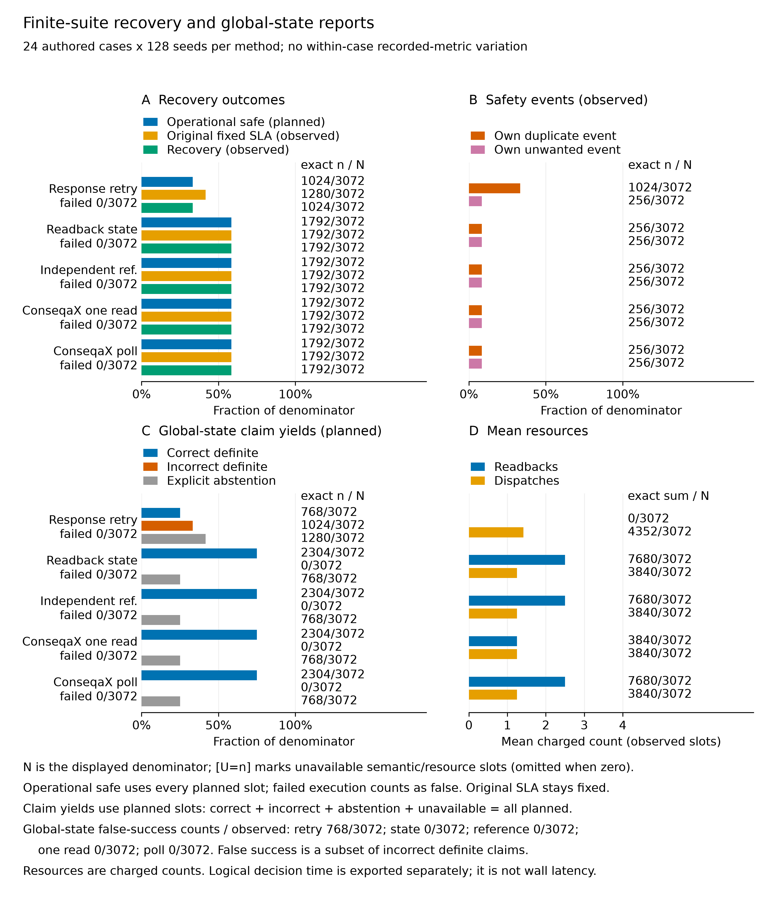
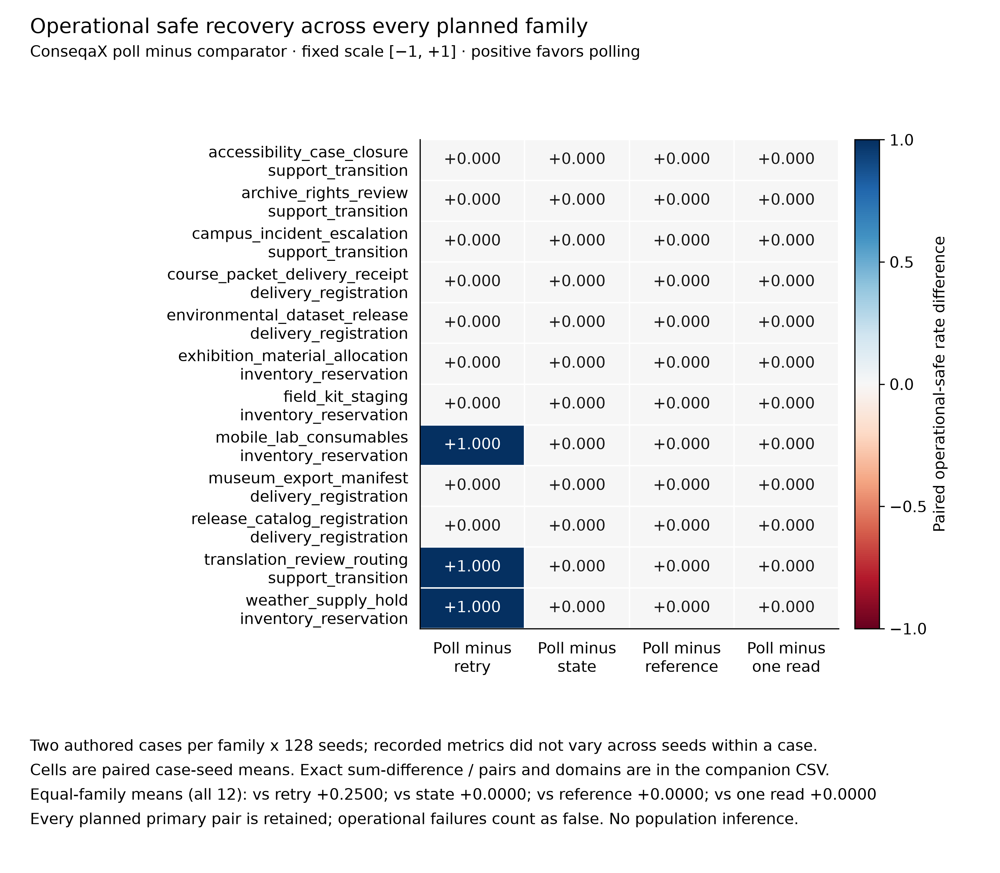
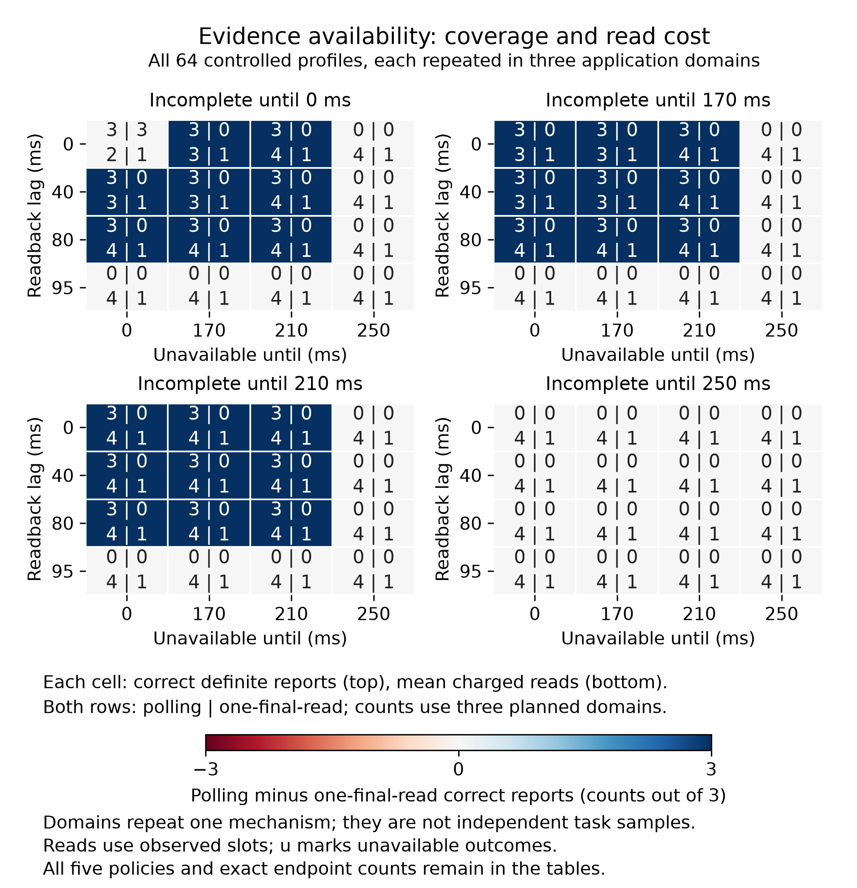
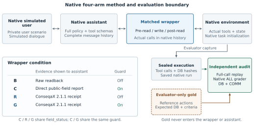

# ConseqaX: An Evidence Protocol for Recovering Ambiguous Agent Actions

Devrajsinh Jhala

Independent Researcher

Generic IEEE conference manuscript reporting an objective software/systems
evaluation. No venue, acceptance, or completed autonomous benchmark evaluation
is asserted.

## Abstract

A timed-out tool call can leave an agent uncertain whether an operation failed or
will commit later. ConseqaX binds temporal contracts, readback witnesses separate
from acknowledgements, and state and action-origin conclusions to an application
recovery policy. We evaluate five deterministic policies in two version-pinned
SQLite studies. Study A retains 15,360 worlds from 24 authored cases in 12
purposive families; its 128 seeds add no recorded-metric variation within
case–policy groups. All four readback policies achieve safe recovery in 14/24
cases, versus 8/24 for response-driven retry. Package-backed polling matches a
strong reference with separate evidence arithmetic and shared transitions. Its
original-contract state reports are wrong in 0/2,304 definite outputs, while
provider harm and later global-count failures remain possible. Polling doubles
reads without improving claims under Study A's schedules. A separately frozen,
post hoc motivated follow-up crosses 64 availability profiles in three domains:
all 960 worlds succeed physically. Polling increases correct-state yield from
3/192 to 81/192 versus one final read, using 741 versus 192 reads; the classical
reference shares this gain. The studies characterize conditional evidence
coverage and cost, not autonomous-agent superiority, general safety, or
task-population improvement. Study A's postcollection packaging deviation
remains disclosed.

**Index terms:** agent systems, outcome verification, recovery, idempotency,
evidence provenance, uncertainty

## 1. Introduction

An agent requests an inventory allocation, ticket, or published artifact. The
provider accepts the operation, but the acknowledgement times out. An immediate
retry may create a second record; stopping may leave the task unfinished. A
separate read can reveal an existing effect, yet even a fresh empty snapshot
cannot establish that the first request will never commit later. A reliable
recovery decision depends on the operation's identity, provider guarantees,
temporal target, and available evidence, rather than the response alone.

Three distinctions matter. First, a response describes a tool interaction,
whereas a readback supplies evidence about external state. Second, global task
satisfaction differs from an effect being linked to this agent's operation.
Another actor can complete the task; missing actor metadata need not imply an
external actor. Third, a hindsight-correct assertion can have been unsupported
when issued. A controller that guesses the eventual outcome correctly has not
thereby justified a retry or a completion claim.

These are established systems and verification concerns [1]–[6]. ConseqaX makes
them explicit in a reusable evidence protocol [7]. Its typed records bind
contracts, attempts, responses, observations, and verification receipts.
Readback distinct from the acknowledgement signal can support satisfied, violated, or unknown state, while
origin remains a separate conclusion. The protocol does not authenticate a
provider or manufacture request finality. Applications supply source semantics
and the policy connecting receipts to actions.

This paper centers that policy boundary. We compare response-driven same-key retry,
state-only readback, a separately implemented provenance-aware reference, a
package-backed single-final-read ablation, and package-backed bounded polling.
Controller actions change subsequent SQLite effects and observations. The experiment
asks whether the declared evidence policy changes safe recovery, final-report
correctness, or definite-report coverage at a measured read/wait cost, and when ordinary
provider idempotency removes the apparent advantage. The endpoints concern
executable contracts, retained effects, and final-report hindsight truth;
subjective explanation quality is outside the study.

The research questions are falsifiable. **Q1:** How does polling change safe recovery
relative to response-driven retry, together with own harmful effects and recovery
failures? **Q2:** Does the package-backed implementation agree with a same-information
reference using separate evidence arithmetic? **Q3:** What additional origin-report
coverage and correctness appear beyond state-only reporting? **Q4:** Does continued
polling change final-report correctness and coverage relative to one final read at its
additional resource cost? **Q5:** What abstention and definite-error tradeoffs remain
under incomplete public histories? Equal or worse recovery, incorrect conclusions,
unnecessary reads, or parity under shared provider guarantees can limit the proposed
benefit.

The contribution is a specified application protocol, a bounded recovery policy,
and a paired closed-loop evaluation of these questions. Separately implemented reference
parity would support observed conformance, without demonstrating superiority.
Because state-only and provenance-aware variants share action transitions,
their comparison isolates reporting rather than a provenance-caused recovery
benefit. The 12 purposive families provide challenge-suite evidence; repeated
seeds do not establish a population of independently sampled tasks.

## 2. Related Work and Positioning

Idempotence and eventual consistency are longstanding systems concerns [1], [2].
Verified Tool Calls separates acknowledgements from independently checked
effects and admits unknown postconditions [3]. Callability Is Not Operability
examines controlled interface ambiguity and terminal agent claims [4]. Agent-tool
anomaly work distinguishes runtime observations from external events [5]. LIMBO
grades committed-effect histories and studies late commits [6]. Consequently,
response/effect separation, effect ledgers, and the danger of ambiguous retries
are foundations and comparison requirements here, rather than priority claims.

PROV-DM represents entities, activities, agents, and responsibility [8]. ConseqaX
is neither a new general provenance model nor a PROV conformance implementation.
Its narrower boundary links operation identity, temporal contracts, individual
observation witnesses, and explicit unknown verdicts. A source-supported origin
link is not proof that the action was counterfactually necessary.

Causal Agent Replay (CAR) performs same-policy interventions with contrastive
suffix and permutation Shapley attribution [9]. Policy-Conditioned
Counterfactual Credit studies verified outcomes under declared interventions
and continuation policies [10]; CausalLoss-Fin jointly intervenes on decisions
and infrastructure messages [11]. Those questions differ from whether a live
recovery action is justified by its available evidence. Our earlier replay
adapter uses existing estimators. The present experiment requires neither
counterfactual writes nor a new attribution method.

AppWorld, ToolSandbox, and $\tau$-bench already evaluate stateful agent
interaction and world outcomes [12]–[14]. A maintained retail/airline corpus and
native DB evaluator also support our earlier model-free transfer experiment
[15], [16]. Replaying reference actions or executing deterministic recovery
logic does not supply an autonomous benchmark score. Section 6 separates native
integration evidence from the planned comparison; broader recovery validation
still requires native reward, matched strong controls, and independently checked
effect histories under relevant faults.

The present contribution is therefore conditional: an executable evidence contract and
an auditable comparison of policy tradeoffs under declared capabilities. Its value must
come from the recovery behavior, final-report correctness, coverage, and cost actually
measured, rather than from attributing established distributed-systems guarantees to a
framework.

## 3. Evidence and Recovery Protocol

### 3.1 Objects and temporal targets

A logical action has stable identity and payload; each dispatch has a distinct
attempt identity. Captured records include the request, provider response,
reported assessment, separately captured observation, and resulting verification
receipt. Reported assessments are outputs, not measurements of hidden reasoning.
An observation states its source, scope, completeness, availability, observation
time, watermark, and effect history. The application declares which source and
clock are authoritative.

Let registration be $t_0$, the original deadline $D$, stability duration $W$, and
original horizon $H=D+W$. The original contract remains fixed. A separate recovery
deadline $R\geq H$ and safety horizon $S\geq R$ define later recovery in this study: its
matching candidates must commit by $R$ and persist through $S$, and its count is checked
throughout $[R,S]$. A later completion may satisfy recovery while violating the original
SLA. Neither a new read nor an explanatory receipt moves $D$.

For the exact-count record contract, a candidate matches the expected business
fields, commits within $[t_0,D]$, and persists through $H$. The declared count
must hold, including the maximum simultaneous matching count over $[D,H]$.
Historical removals and transient extras therefore matter; a current-row
snapshot alone is insufficient. Simultaneous commits and removals are evaluated
together, with boundary conventions fixed before collection.

The verifier concludes satisfied, violated, or unknown. A complete admitted
observation must cover the registered scope and history through $H$. Stale
watermarks, inadequate scope, unavailable reads, or malformed history retain
unknown. Source identity, completeness, timestamps, and provenance are trusted
adapter declarations. Schema checks and hashes establish structure and retained
bytes, not source authenticity or transactional guarantees.

### 3.2 State, origin, and support

Global state satisfaction does not require this agent to have produced the
effect. Action-linked satisfaction additionally requires qualifying target
evidence linked to the logical operation. A known global violation makes this
linked contract false even if an own matching record exists: a second effect
can invalidate an exactly-one task. Mere witness presence cannot replace the
whole contract.

A matching action identity with absent or matching actor metadata can support
linkage under the admitted provenance law. Explicitly different identities
exclude this operation; missing or conflicting linkage can remain unknown.
Provenance does not turn an externally satisfied state into a failure. Each
observation retains its own witnesses. A later record sharing an effect ID
cannot inherit an earlier observation's origin link while silently changing
payload, actor, or removal history.

Hindsight correctness and evidence support are distinct questions. The present evaluator
scores final state and action-linkage reports against full-ledger truth, with separate
definite-report and abstention counts. It does not independently label support at
issuance or score safe-to-retry assertions. Raw public histories and final claims are
retained for artifact inspection; a hindsight-correct guess alone does not
establish support. An origin abstention does not erase a definite state conclusion.
Conditional error among definite assessable reports and correct definite yield over all
planned worlds answer different questions.

### 3.3 Why historical absence cannot resolve a pending attempt

**Conditional retry boundary.** Suppose an operation times out without atomic
deduplication, terminal resolution, completed cancellation, or an enforceable
in-flight bound. Let $L<R$ be the last useful retry time. Two provider worlds
give identical admissible histories through $L$: the initial attempt never
commits in one and commits after $R$ but by $S$ in the other. A retry by $L$
achieves recovery by $R$; a later retry cannot. An extra effect is harmful even
if compensated, and no alternative operation achieves the target.

A deterministic policy takes the same decision in both histories. Retrying
creates a duplicate in the late-commit world; declining misses recovery in the
never-commit world. For a randomized policy, couple its randomness and let $p$
be its useful-retry probability. Duplicate risk in the second world is at
least $p$ and missed-recovery risk in the first at least $1-p$. Their sum is at
least one for this constructed pair. This elementary indistinguishability
argument states a known systems boundary [6], rather than a new impossibility
or a measured prevalence. Provider guarantees can break its assumptions.

### 3.4 Application safety gate and bounded reads

Every policy preserves the operation key and payload. When a public native
idempotency capability is admitted, the provider atomically reserves pending
and completed work for that key. All readback policies may use the same-key
exception to retry within the common cap before $D$. The response-driven arm
also benefits from the identical provider semantics; it is the ordinary
bounded idempotent-retry comparator in that stratum.

Without that capability, the readback policies permit another dispatch only
when every previous attempt has an admitted terminal-no-effect guarantee,
fresh complete trusted readback establishes no relevant effect through the
decision time, budget remains, and time is strictly before $D$. A newer
terminal response does not resolve an older ambiguous request. An empty
watermark proves only past absence; it supplies no terminal guarantee.
Resolution of the agent's attempts also cannot prevent another actor's future
write. Global race freedom would require additional provider semantics.

The package's generic retry advice is recorded, but this application gate
authorizes dispatches. Provisional predeadline verification has its own target
ending at the current time; it never replaces the fixed $D/H$ receipt.
Bounded polling uses externally scheduled callbacks rather than the public
blocking polling helper, allowing all arms to share admitted opportunities.
At exhaustion, insufficient evidence remains an abstention. No policy dispatches
after $D$; recovery at $R$ is a distinct evaluator outcome, not an extension of
the original dispatch window.

## 4. Frozen Closed-Loop Study

### 4.1 Corpus, separation, and execution

The schedule crosses 24 new cases, 128 timing seeds, and five policies:
15,360 planned worlds. Cases span 12 purposive families in three nonpayment
SQLite domains: inventory, tickets, and artifacts. Related cases share
mechanisms; identifiers and seeds do not create new families. Separate AI
agents authored controllers and cases. The controller author never inspected
the case file, and the lead integrator did not manually inspect case values
before freeze. This is procedural separation within an AI-assisted workflow,
without external human authorship or random task-population sampling.

Each world uses a fresh database. The frozen exogenous event schedule, timing
seed, provider law, source behavior, budgets, and read opportunities are paired
across policies. Actions create branch-specific effects, so later observation
contents can legitimately diverge. Matching means equal capabilities and
opportunities, not forcing one policy to consume another's realized evidence.
Readback is a separate application method that queries the same SQLite effect
ledger through the same connection after advancing the simulated world. Its
contents are distinct from the acknowledgement signal; it is not an independent
connection, source, or trust domain. Only the postcollection auditor opens
retained database snapshots read-only.

The public allowlist includes request/contract, identities, response history,
provider capability and terminal receipts, and scoped readback history.
Controllers receive no case/family/fault labels, hidden future events, evaluator
truth, or another policy's reports. They are deterministic application state
machines. The run requires no LLM, user simulator, remote provider, or paid API
call and supplies no autonomous-agent benchmark reward.

### 4.2 Five policies and the strong comparison

| Policy | Evidence interpretation | Recovery and reads |
| --- | --- | --- |
| `response_retry` | ACK/error proxies for state and action completion; unresolved timeout unknown. | Retry ambiguous timeouts with the same key within the cap and original deadline. |
| `readback_state` | Trusted complete history for global state; abstain on provenance when state holds. | Shared gate and bounded scheduled reads. |
| `reference` | Independent standard-library count/time and provenance arithmetic. | Same application state machine and read opportunities as polling. |
| `consequax_one_read` | Public 2.1.1 verification receipts plus explicit linkage uncertainty. | Gate-relevant predeadline queries; one final horizon-eligible query. |
| `consequax_poll` | Same public verification and linkage rule. | Shared gate with continued scheduled reads until known or exhausted. |

The single-read arm is not forced to spend its final query before $H$. It may
perform a predeadline gate query when terminal guarantees make retry relevant;
its first query at or after $H$ is its only final query. Polling can use later
opportunities to resolve lag, incompleteness, or unavailability. Equal maximum
budgets need not yield equal spend; early stopping and skipped queries are
policy outcomes.

The reference imports no package verifier. The controller author implemented its
evidence arithmetic separately, while sharing the declared application transition logic
with the polling comparison. Thus exact agreement is a conformance result, not a contest
between independently designed recovery algorithms or external implementations.
State-only and provenance-aware arms likewise do not test a provenance-caused action
benefit when transitions coincide. They test origin-report coverage and correctness
under the admitted provenance law.

### 4.3 Endpoints, costs, and finite-suite analysis

The primary all-slot endpoint is **operational safe recovery**: the global recovery
payload/count contract holds by $R$ and persists through $S$, with neither an own
duplicate nor an own unwanted effect committed through $S$. An own duplicate means more
cumulative own committed effects than the allowed logical-operation count, including
effects later removed. An own unwanted effect mismatches the expected business fields or
commits after $R$. These predicates do not certify the absence of every harmful external
activity; another actor's effects can still violate the global recovery count. Every
scheduled cell remains in the operational denominator, and failed or unstarted execution
cannot earn success. Failed cells' semantic state, origin, and harm outputs remain
unavailable rather than receiving fabricated violation labels; an incomplete collection
cannot yield a complete audited result. Own duplicate and unwanted events are mandatory
companions, including effects subsequently removed. If safety is unauditable, all-slot
harm lower/upper bounds must expose that uncertainty.

Retained truth records distinguish original $D/H$ satisfaction, operation-linked
satisfaction, and controller-created effects. The summary scores the final state and
action-linked reports for hindsight correctness, false success, definite coverage, and
abstention. Conditional error is wrong definite outputs divided by definite assessable
outputs; correct definite yield uses all planned worlds. A zero-claim error rate is
undefined. Semantic rates and resource means use observed completed cells with
unavailable counts shown; the primary operational score and claim yields retain planned
denominators. Evidence support at issuance is not a scored endpoint. External
completion does not establish successful execution by this controller.

For family $f$ and policy $m$, let $y_{fm}$ be mean operational safe recovery
over every scheduled case/seed cell in that family. The predeclared primary
contrast is

$$
\Delta = \frac{1}{12}\sum_{f=1}^{12}
  (y_{f,\mathrm{poll}}-y_{f,\mathrm{response}}).
$$

The full 12 paired differences accompany the equal-family mean and all-slot
cell totals. Secondary views compare polling with state-only and one-read;
reference agreement is implementation checking. Capability, domain, and fault
strata are descriptive. No population p-values, task-population confidence
intervals, equivalence, or noninferiority claims follow from these purposive
families. Timing-seed replication characterizes this fixed suite, not new
independent tasks. Any seed-law uncertainty must identify its own sampling
assumptions and cannot supply task-population inference.

The analysis retains actual dispatches, readbacks, wait decisions, and logical decision
time under shared ceilings, separating evaluator audit work. Accounting includes
unsuccessful requests and timeout dispatches. Provider terminal guarantees are response
fields; separate resolution, cancellation, and refused-request cost endpoints are not
implemented. A zero-success cost-per-success ratio is undefined. Host runtime is
separate from simulated logical time; one local collection does not establish intrinsic
production overhead, wall latency, or service charges.

### 4.4 Freeze and first-run integrity

The pinned 2.1.1 wheel runtime is bound to study source
`22e88498cff0e2afd1549803fb4d9645902e74b9` and protocol commit
`3d3dd4ca663d3e16c7cb1ead4c59c724af9bedd7`. Protocol SHA-256 is
`b5c6a06bf1d758678e4d9890aa66872d4036634e2a4a4fd89626bd710bbc5aaa`. The artifact binds
corpus, schedule, controllers, provider/evaluator law, analysis, Python executable
identity, and installed framework source/runtime before measured execution. It retains
first-run cells, failures, stop/abstain decisions, and deviations. Corrections after
exposure require a separate version; deterministic re-execution cannot replace the
original denominator or create new independent trials. Hashes identify bytes rather than
authenticating the source's semantic claims.

A packaging deviation is retained explicitly. All scheduled trials, database
snapshots, journal rows, and the summary were present when the session resumed,
but the original runner's terminal manifest and receipt were absent. Its exit
status and termination cause are unknown. A separate postcollection finalizer
preserved every existing byte, rechecked source/runtime/claims, and created only
the missing packaging files. It did not resume or rerun worlds or regenerate
the summary. The completion timestamp denotes packaging time. The unchanged
frozen auditor subsequently checked database lifecycles and recorded endpoints; neither this audit
nor retained claims prove absence of off-record execution or earlier tampering.

## 5. Recovery Results

### 5.1 Retained collection and effective diversity

All 15,360 scheduled worlds are retained: 3,072 planned and completed worlds per
policy, with zero execution failures. The unchanged [original-host semantic
auditor](../output/recovery-controller-audit-2026-10-20/audit-receipt.json) queried
every SQLite snapshot and recomputed the endpoint summary. The [portable
retained-artifact audit](../output/recovery-portable-audit-2026-10-20/portable-audit-receipt.json)
also passed and queried all 15,360 snapshots. The portable audit does not verify
the original host or live claims. Separate audit code does not supply independent
external replication; its author also authored the controllers.

The [prospective protocol](../output/recovery-controller-protocol-2026-10-20/protocol.json)
has SHA-256 `b5c6a06bf1d758678e4d9890aa66872d4036634e2a4a4fd89626bd710bbc5aaa`
and binds source `22e88498cff0e2afd1549803fb4d9645902e74b9`. Section 4.4's
packaging deviation remains part of this result. The [finalization record](../output/recovery-artifact-finalization-2026-10-20/finalization-record.json),
SHA-256 `26fabbec4c16af115ad367086efd247e0660af801f0290fe57fa4265a84440a0`,
records preservation of all retained bytes and creation only of the missing
terminal manifest and receipt, with no worlds rerun or summary regeneration.
The original exit status and termination cause remain unknown. Packaging time
is not a recovered original completion time, and retained artifacts cannot
prove absence of off-record execution or earlier tampering.

Across all 120 case–policy groups, none of the recorded endpoint or resource
metrics varied over the 128 seeds. Some exogenous timestamps varied, but the
repetitions added no endpoint diversity. The substantive challenge set therefore
remains **24 authored cases in 12 purposive families**, rather than 15,360
independent tasks. The [retained summary](../output/recovery-controller-study-2026-10-20/summary.json)
and [paired exports](../output/recovery-publication-figures-2026-10-20-v3/paired-contrasts.csv)
retain the exact finite-suite counts; no task-population inference follows.

### 5.2 Recovery, harms, and the strong comparison

Every readback policy achieved operational safe recovery in **1,792/3,072 worlds
(14/24 cases)**, compared with **1,024/3,072 (8/24)** for response-driven retry.
The predeclared equal-family primary difference was **+0.25**. Of the 12 family
contrasts, three were +1 and nine were zero. Differences against the separate
reference, state-only, and one-final-read policies were zero in every family.

The three positive families have specific explanations. In weather-supply and
translation-routing cases, response-driven timeout retries created an extra
non-idempotent effect; the readback policies dispatched once. In mobile-lab
cases, the first response explicitly terminated without an effect; readback
policies verified fresh absence and retried, while the response baseline's
declared error rule stopped. This third gain concerns that particular rule,
rather than superior deduplication. The equally informed classical reference
achieved the same recovery as the package.

Every policy below has 3,072 planned and completed worlds. Original **D/H**
satisfaction and recovery **R/S** are distinct temporal targets: later recovery
cannot repair an original SLA violation. Safe recovery additionally excludes
own duplicate and unwanted events through S. These event categories can
overlap. Means are exact charged counts, not wall latency.

| Policy | Safe recovery | Original D/H | Recovery R/S | Own duplicate | Own unwanted | Mean reads | Mean dispatches |
| --- | ---: | ---: | ---: | ---: | ---: | ---: | ---: |
| Response retry | 1,024/3,072 | 1,280/3,072 | 1,024/3,072 | 1,024/3,072 | 256/3,072 | 0 | 17/12 |
| Readback state | 1,792/3,072 | 1,792/3,072 | 1,792/3,072 | 256/3,072 | 256/3,072 | 5/2 | 5/4 |
| Separate reference | 1,792/3,072 | 1,792/3,072 | 1,792/3,072 | 256/3,072 | 256/3,072 | 5/2 | 5/4 |
| ConseqaX one final read | 1,792/3,072 | 1,792/3,072 | 1,792/3,072 | 256/3,072 | 256/3,072 | 5/4 | 5/4 |
| ConseqaX polling | 1,792/3,072 | 1,792/3,072 | 1,792/3,072 | 256/3,072 | 256/3,072 | 5/2 | 5/4 |

Residual harm is material. In the same **256 archive-rights worlds**, one initial
provider dispatch created two wrong-payload effects. These are both duplicate
and unwanted events, not 512 distinct harmed worlds. Detection did not cancel or
repair the effects. Environmental-release cases supply a different failure: an
external actor satisfies the original contract, then a delayed own effect breaks
the later exact-count target without an own duplicate or unwanted flag. All 256
response worlds with original satisfaction but failed recovery belong to this
family. Equal aggregate original/recovery counts for the readback policies
conceal a 256-world later-recovery gain and a different 256-world later loss.
One target cannot substitute for the other.

All 3,072 reference–polling pairs agreed on final state/linkage reports, endpoint
vectors, controller action sequences, and full retained truth. This is observed
implementation conformance under the shared policy, not superiority over the
strong reference. State-only and polling also had identical actions and physical
histories; 1,024 pairs differed in the action-linked report. Provenance expanded
reporting here, without a recovery-action benefit.

### 5.3 Reporting and the cost of additional polls

The table concerns final reports about the **original contract**. Conditional
error is wrong/definite; correct yield is correct/planned. Both positive and
negative conclusions count. These are hindsight truth comparisons; they do not
measure evidence support at issuance or certify later recovery.

| Policy | State error | State correct yield | Linked error | Linked correct yield |
| --- | ---: | ---: | ---: | ---: |
| Response retry | 1,024/1,792 | 768/3,072 | 768/1,792 | 1,024/3,072 |
| Readback state | 0/2,304 | 2,304/3,072 | 0/1,024 | 1,024/3,072 |
| Separate reference | 0/2,304 | 2,304/3,072 | 0/2,048 | 2,048/3,072 |
| ConseqaX one final read | 0/2,304 | 2,304/3,072 | 0/2,048 | 2,048/3,072 |
| ConseqaX polling | 0/2,304 | 2,304/3,072 | 0/2,048 | 2,048/3,072 |

The response policy made 768 false-success and 256 false-negative state reports.
The readback policies made no wrong definite state report, but abstained in
768/3,072 worlds. Provenance-aware policies retained 1,024/3,072 linked
abstentions; state-only retained 2,048/3,072. Correct negative reports contribute
to these yields. Zero wrong original-contract reports did not imply zero harms
or guaranteed safe recovery. A hindsight-correct guess does not establish
evidence support at issuance.

Polling and one-final-read agreed on both final claims, dispatches, effect
histories, and every endpoint other than polling cost in all 3,072 pairs.
Polling nevertheless consumed **7,680 reads versus 3,840**, with mean logical
decision time **220 versus 200 ms**. These are simulated decision times, not
measured production latency. The schedule explains the negative finding: no
case with insufficient evidence at H became admissibly known at H+40 or H+80.
Transient limitations either cleared before the first final read or persisted
beyond the last opportunity. Thus Study A shows no incremental polling utility
under its schedules; it leaves a design-coverage gap for recoverable lag.

The [method overview PDF](../output/recovery-publication-figures-2026-10-20-v3/recovery-method-overview.pdf)
and [exact metric table](../output/recovery-publication-figures-2026-10-20-v3/summary-metrics.csv)
distinguish reporting correctness, physical recovery, and evidence support.
All recorded metrics were constant across seeds within each authored case.
Reference independence concerns evidence arithmetic; application transitions
and controller authorship are shared.

The [family-contrast PDF](../output/recovery-publication-figures-2026-10-20-v3/recovery-family-primary-contrasts.pdf)
and [complete family table](../output/recovery-publication-figures-2026-10-20-v3/family-safe-recovery-contrasts.csv)
show an equal-family difference of +0.25 against response retry and zero against
all three readback comparators. Each purposive family has two related cases and
128 seeds; the repetitions added no recorded-metric variation or independent
task-population evidence.

### 5.4 Study B: controlled evidence availability

Study A's coverage gap motivated this follow-up after its outcomes were known.
The world, controllers, and evaluator remain byte-identical; a new complete
factorial grid was frozen before collecting its own data. Source commit
`d805b3e3560c05ee0a7efd02a80fc18503c6ee05`, protocol commit
`b937920469285cdd971783fa6cb33216a7e4da13`, and
[protocol](../output/recovery-availability-protocol-2026-10-20/protocol.json)
SHA-256 `e874c6781aa0dbc8ef682ea0a8d37c25d73cc861dada05fd0379116d4a7f6584`
bind the design. This is a disclosed, post hoc motivated sensitivity experiment,
not a new held-out corpus or a replacement for Study A.

The 64 profiles cross readback lag **{0, 40, 80, 95} ms** with independently
varied unavailable-until and incomplete-until times **{0, 170, 210, 250} ms**.
Each profile repeats in three domains at seed zero: 192 cases and 960 scheduled
policy worlds. Here D = 100, H = 150, R = 250, and S = 330 ms; read opportunities
are 50, 150, 190, and 230 ms. Every initial dispatch acknowledges at 2 ms and
creates one correct effect at 10 ms. All arms share native idempotency; there
are no external writes, removals, or wrong effects. This intentionally uniform
physical-success design isolates evidence-window coverage and cost. The
domains repeat the same mechanisms; 192 cases and 960 worlds are not
independent task samples.

All 960 worlds completed without failure. The
[saved-artifact audit](../output/recovery-availability-audit-2026-10-20/audit-receipt.json)
verified 1,925 retained artifact hashes, queried all 960 SQLite snapshots, and
agreed with the summary. Recorded-host byte checks were enabled; they do not
attest historical execution. Unlike Study A, this collector produced its
terminal manifest and receipt normally. All five policies dispatched once,
achieved original and recovery satisfaction in 192/192 worlds, and had zero
duplicate or unwanted events. Physical effect histories agreed in every
five-arm case. The primary safe-recovery contrast is therefore zero.

Every policy below has 192 planned and completed worlds. Every definite report
is hindsight-correct in this uniform-success design; it cannot estimate the
response policy's false-success risk. Linked abstention is distinct from state
abstention.

| Policy | State correct/planned | State unknown | Linked correct/planned | Total reads | Mean decision (ms) |
| --- | ---: | ---: | ---: | ---: | ---: |
| Response retry | 192/192 | 0/192 | 192/192 | 0 | 2 |
| Readback state | 81/192 | 111/192 | 0/192 | 741 | 224.375 |
| Separate reference | 81/192 | 111/192 | 81/192 | 741 | 224.375 |
| ConseqaX one final read | 3/192 | 189/192 | 3/192 | 192 | 150 |
| ConseqaX polling | 81/192 | 111/192 | 81/192 | 741 | 224.375 |

The one-final-read policy resolved one of 64 profiles per domain; polling
resolved 27, matching the prospectively specified timing calculation. The
paired correct-state-yield increase is **78/192 = 26/64 = 0.40625**, shared by
the reference and state-only readback. All 192 reference–polling pairs agreed
on reports, endpoint vectors, dispatch decisions, and physical records.
State-only differed from polling in 81 linked reports while preserving actions
and physical outcomes. State-only abstained on all 192 linked conclusions;
reference and package polling retained 111 linked abstentions, and one final
read retained 189. These are observed comparisons, not forced hypothesis
agreement or participant judgments.

Polling used **741 reads versus 192**, or 3.859375 versus one per world; mean
logical decision time increased by **74.375 ms**. These are charged simulated
reads and decision times, not production latency. The
[coverage analysis](../output/recovery-availability-audit-2026-10-20/coverage-analysis.json)
retains every profile's observed coverage and resource values.

Late opportunities help only when availability and completeness recover and
the watermark reaches H. Lag 95 ms and either window persisting through 250 ms
remain unresolved. The ACK-driven response policy reports all 192 successes
correctly in hindsight with no read because all effects are constructed to
succeed. Its report arrives before the effect and without horizon-covering
evidence; this experiment supplies no estimate of its risk in failing worlds.
Together, the studies show conditional polling utility and its cost, with no
package superiority over the equally informed reference, no additional
recovery-action benefit, and no task-population inference.

## 6. Native Integration and Prospective External Pilot

### 6.1 Retained integration finding

A separate local integration check executes the maintained airline environment
at revision `96a3ef92329baf908ffe9dfe188cea34e8701d2a`, distributed as `tau2`
1.0.1 [15], [16]. The native assistant and dynamic user both use local Qwen3 4B
Instruct inference. This is actual autonomous dialogue, rather than reference-action
replay, but the development task is excluded from the planned comparison. The
unwrapped native condition does not import or invoke ConseqaX.

The [final-source check on development task 19](../output/native-development-2026-10-21/native-19-002-audit/audit-result.json)
returned **12 model completions and five native tool calls**, ending with native
`user_stop`. An offline auditor verified all eight execution-source files,
272 bound upstream files, 54 installed framework payload files, and exactly one
actual HTTP generation dispatch per recorded completion. It linked canonical parsed HTTP
requests to context checks and strict native inputs; replayed initialization and
every tool call, including reads; checked initial/final database snapshots; and
reproduced native ALL grading. The raw inventory was created after collection.
Offline render/token checks validate saved collector observations rather than rerunning
the server or tokenizer; discarded JSON key order prevents reconstruction of the
original wire serialization. The native reward was **0**: DB reward 0, with
COMMUNICATE 1 because this task has no communication requirement. Vacuous
communication success is not evidence of substantive explanation quality.
Artifact consistency does not turn a failed native task into a successful evaluation.

The model journal retained **53,420 prompt tokens and 1,228 completion tokens**
across both model roles. Prompt totals already include cached tokens. The maximum
complete prompt was 7,536 tokens; required context including the output allowance
and margin was 8,112 of 16,384 tokens. Execution took 1,806.5 seconds on this CPU
host. These observations characterize one development execution, not framework
overhead, a comparative success rate, or a task-population estimate. Bound execution
source is `8bd1cd88ab3644a9c6417e29308ab4b502b40484`; the separate audit and its
complete manifest are retained.

Development failures are retained as well. An [earlier guarded execution](../output/native-development-2026-10-21/guarded-20-000/parent-receipt.json)
ended at a 600-second request timeout, after seven invocations and six returned
completions, without a returned native simulation or grade. Its task reward is
unavailable, rather than an invented semantic zero. Before any official collection,
the [candidate condition was amended uniformly](../docs/native-resource-amendment-2026-10-21.md#full-history-cpu-timeout-amendment-before-official-collection)
to 1,200 seconds per request and 7,200 seconds per trajectory. The final guarded
readiness check remains separate from any official pilot outcome. **No comparative
pilot score is reported here.**

### 6.2 Matched conditions and audit boundary

The prospective design selects **12 distinct airline task IDs** by a declared
metadata-based hash rule, excluding development IDs 19 and 20. Six tasks have
substantive communication criteria and six have empty criteria. Four conditions
and one declared seed give **48 planned trajectories**, not 48 independent tasks.
Task and rotating condition order must be published with the execution protocol
before official generation. The corpus was exposed in the earlier model-free
transfer study; these are externally authored, previously exposed tasks, not an
author-unseen holdout.

All conditions retain the complete native policy, tool schemas, actual environment,
dynamic user, and required DB plus COMMUNICATE reward. Proposed mutations determine
a shared public-read schedule; subsequent dialogue and evidence can diverge.

| Condition | Derived public report | Dispatch guard |
| --- | --- | --- |
| B | Raw public reads, without a derived verdict or framework import | None |
| C | Compact current-field report, direct standard-library predicate | Conservative guard |
| R | ConseqaX 2.1.1 current-field receipt | None |
| G | ConseqaX 2.1.1 current-field receipt | Same guard as C |

C, R and G use the same `field_status` application predicate. G invokes it through
a custom package verifier and emits a full receipt, while C emits a compact report.
C/G therefore tests integration, representation and guard interactions, not independent
verifier arithmetic or the built-in temporal `RecordVerifier`. Shared predicate errors
can survive automated agreement. The guard can suppress a legitimate later identical
request and may never activate in ordinary dialogue; either outcome must be retained.

Planned shared ceilings are 80 native steps, 48 combined assistant/user model
invocations, 512 generated tokens per request, and the amended request/trajectory
deadlines above, with no corrective retries. Every generation must pass a complete-history
render, token-ID/context check and model-identity check without history trimming.
Local request normalization is restricted to the pinned provider's disclosed schema
serialization and ordinary assistant null-field omission. A failed gate stops that
trajectory; no replacement completion is silently substituted.

The primary finite-pilot endpoint is operational full native reward over all 12
planned slots per condition. Failed or unstarted slots cannot earn operational
success. Unavailable native reward and components remain unavailable; native
premature termination retains zero reward with missing component grades. Empty
communication criteria pass vacuously only when component evaluation is reached.
A passed artifact audit does not imply that all planned slots ran or any task
succeeded. All planned dispositions, complete accounting, observed journal prefixes
and missing usage must remain distinguishable.

A separately implemented auditor imports neither the collection runner, wrapper,
transport nor framework. It reconstructs all actual calls chronologically and
regrades saved native trajectories through the unchanged evaluator. Additional
read replay matters because native strict replay skips nonmutating reads. This
is automated checking within the same AI-assisted project, not independent
external replication. Native synchronous execution injects no lost acknowledgement
or delayed commit. Current public fields do not establish temporal durability,
settlement, safe retry, or action origin; receipt origin remains unknown. The same
small model supplies assistant and user, one seed does not estimate execution
variance, and persistent prompt caches plus shared host load prevent causal
wall-time attribution to the package.

## 7. Supporting Evidence and Version Boundaries

Earlier experiments corroborate narrower components, rather than multiplying
the new recovery study's independent task count. The supporting-evidence table separates their units,
targets, and versions [17], [18]. Detailed calibration and attribution results
remain in the historical manuscript and versioned evidence ledger.

| Study and version | Retained evidence | Supported interpretation and limit |
| --- | --- | --- |
| Factual auditing, 1.1.0/schema 0.1 | 503/504 episodes, three small local models; 431 correct definite state claims and 72 unknown; reference/package agreement on all completed episodes. | Captured-evidence agreement; no closed-loop recovery intervention or independent-task inference. |
| Same-evidence judge, 1.1.0 | 84 traces; 9 wrong among 60 definite judge state claims; action-linkage outputs all unknown. | One small local judge, including correct guesses outside the fixed mechanical evidence rule; no general LLM ranking or subjective explanation-quality result. |
| Model-free tool transfer, 1.1.0 | 656 retail/airline task-control cells; 900 operation captures. | Native DB end-state matching differs from immediate requested-field checks; no autonomous reward. |
| Native CAR bridge, 1.1.0 | 1,024 paired groups; 640 eligible point vectors agree, 384 unavailable. | Matched scripted-game compatibility; 64 already ineligible budget groups have disclosed refusal-record coalescing. |
| Offline migration, 2.0 | 503 retained traces / 504 original slots preserve canonical conclusions, including 72 unknowns; 275 diagnosis-code changes. | Exposed-data conformance with no new actions/model calls; no new accuracy or broad feature validation. |

The new experiment uses selected 2.1.1 public recording, contract, observation,
and record-verification paths [7]. Its callback-based application polling and
safety gate are explicit integration code. It does not evaluate the public
blocking polling helper, composite/multiple-source verification, OpenTelemetry,
SDK integrations, arbitrary multi-action traces, or the full release surface.
Historical 1.1.0 results and 2.0 migration are not relabeled as 2.1.1 performance.
Byte-identical numerical modules alone would not establish end-to-end version
equivalence.

## 8. Discussion and Limitations

An evidence protocol is useful only under meaningful source and operation
semantics. A watermark covers history through a declared time; finite auditing
through $S$ cannot prove absence of all future effects. Provider deduplication
or terminal resolution is supplied equally to every arm, not created by
verification. Concurrent external actors remain a distinct source of harmful
global count changes. These assumptions constrain any recovery conclusion.

Strong-reference parity should be interpreted directly. Separate arithmetic reduces
reliance on one verifier implementation, but a shared controller author and application
state machine can preserve shared mistakes. The saved-artifact auditor uses separate
code, while its author also implemented the controllers; this is not external
replication. Exact agreement on this suite is neither superiority nor a proof of general
safety. Advantages over response or state ablations must identify the omitted evidence
and the precise claim or decision it changes. If provenance changes only reporting, that
is the measured boundary; a causal action benefit cannot be inferred.

The task set is small, purposive, AI-authored, and implemented on one local
substrate. Three record domains broaden application vocabulary and predicate
use without establishing transfer to independent services. Repeated timing
seeds cannot repair this external-validity gap. Deterministic policies exercise
recovery logic, not language understanding, user negotiation, planning,
provider authentication, or autonomous tool selection. These data can characterize
a conditional decision boundary; they cannot establish general autonomous-agent
improvement or effectiveness across independently operated services.

This is a software/systems evaluation grounded in SQLite state and effect-ledger
truth, separately implemented reference rules, automated artifact audits, and
controlled comparisons. These methods do not evaluate interpretability,
preferences, or rationale quality. The historical T15 unblinded rationale claim
is excluded from the current paper and is not empirically validated here.

The pending native comparison extends execution to an externally authored
environment but does not inject ambiguous commits. The next fault-focused
validation should freeze selection and a real agent policy in an external
benchmark or provider sandbox, preserving strong classical recovery controls
under identical capabilities and budgets. Native reward must accompany
independently checked effect histories and validation of adapter/status/idempotency
semantics. The supplied strong guards and committed-effect grading of LIMBO [6]
are relevant comparators, rather than novelty claims for this framework. A declared
sampling design and precision target are necessary for broader inference.
More internal cases, AI audits, or reference-action replay cannot substitute
for this validation.

## 9. Conclusion and Artifact Availability

ConseqaX provides inspectable boundaries between tool responses, verified
temporal state, operation-linked origin, and explicitly recorded assertions
and evidence. The studies evaluate the application decisions and resource costs
that follow from those boundaries under shared provider guarantees. Its scope
is a frozen challenge suite, a controlled availability grid, and deterministic
recovery policies. Historical
model, transfer, replay, and migration evidence retains its original versions
and targets. Comparisons use established provider guarantees as shared assumptions
and treat reference agreement as conformance.

The current MIT distribution is version 2.1.2 [19]; this experiment retains
its 2.1.1 pin [7]. The public repository retains protocols,
source hashes, schedules, raw traces, dispositions, evaluator arithmetic, and
deviations. A DOI-backed immutable research archive has not yet been established.
The earlier manuscript preserves full replay
definitions, interval tradeoffs, source pins, and historical audits. No real
payment or production-service write is part of the reported recovery experiment.

## AI Assistance and Verification Disclosure

Generative AI assisted software development, case creation, source inspection,
automated artifact checking, and manuscript drafting. Separate AI authorship
and saved-artifact audits do not constitute external replication. No participant
study, interpretability result, preference judgment, or rationale-quality result
is reported.
The author is responsible for the manuscript and venue-required disclosure.

## References

1. P. Helland. “Idempotence Is Not a Medical Condition.” *Communications of the ACM*, 55(5), 56–65, 2012. [Publisher record](https://doi.org/10.1145/2160718.2160734).
2. W. Vogels. “Eventually Consistent.” *Communications of the ACM*, 52(1), 40–44, 2009. [Publisher record](https://doi.org/10.1145/1435417.1435432).
3. I. K. Mansoor, A. Phadke, and P. Rana. “Verified Tool Calls Improve LLM Agent Reliability Under Non-Atomic Failures.” arXiv:2608.02645v1, 2026. [Inspected version](https://arxiv.org/html/2608.02645v1).
4. Z. Wang. “Callability Is Not Operability: Controlled Interface Interventions for LLM Agents.” arXiv:2608.23628v2, 2026. [Inspected version](https://arxiv.org/html/2608.23628v2).
5. A. Trofimov and B. Novikov. “When Tool Calls Succeed but Workflows Fail: Anomalies at the Agent-Tool Boundary.” arXiv:2609.15397v1, 2026. [Inspected version](https://arxiv.org/html/2609.15397v1).
6. J. Li. “Where Does Exactly-Once Live? Model, Harness, and Tool-Contract Effects on Duplicate Side Effects in LLM Agents.” arXiv:2609.29095v1, 2026. [Inspected version](https://arxiv.org/html/2609.29095v1).
7. D. Jhala. *ConseqaX*, MIT Python distribution, 2.1.1, 2026. [Package](https://pypi.org/project/consequa-x/2.1.1/); [source and evidence](https://github.com/Devrajsinh-Jhala/consequa-x).
8. L. Moreau and P. Missier, eds. *PROV-DM: The PROV Data Model*. W3C Recommendation, 2013. [Recommendation](https://www.w3.org/TR/2013/REC-prov-dm-20130430/).
9. J. Shah. “Causal Agent Replay: Counterfactual Attribution for LLM-Agent Failures.” arXiv:2606.08275v1, 2026. [Inspected version](https://arxiv.org/html/2606.08275v1).
10. R. Meng. “Policy-Conditioned Counterfactual Credit for Verifiable Reinforcement Learning of Long-Horizon Language Agents.” arXiv:2606.05263v1, 2026. [Inspected version](https://arxiv.org/html/2606.05263v1).
11. A. Sharma. “CausalLoss-Fin: Attributing Financial-Agent Loss to Decisions and Infrastructure Faults.” arXiv:2609.25960v1, 2026. [Inspected version](https://arxiv.org/html/2609.25960v1).
12. H. Trivedi et al. “AppWorld: A Controllable World of Apps and People for Benchmarking Interactive Coding Agents.” ACL, 2024, 16022–16076. [Proceedings](https://doi.org/10.18653/v1/2024.acl-long.850).
13. J. Lu et al. “ToolSandbox: A Stateful, Conversational, Interactive Evaluation Benchmark for LLM Tool Use Capabilities.” Findings of NAACL, 2025, 1160–1183. [Proceedings](https://doi.org/10.18653/v1/2025.findings-naacl.65).
14. S. Yao, N. Shinn, P. Razavi, and K. Narasimhan. “$\tau$-bench: A Benchmark for Tool-Agent-User Interaction in Real-World Domains.” arXiv:2406.12045v1, 2024. [Inspected version](https://arxiv.org/html/2406.12045v1).
15. Sierra Research. Maintained retail/airline task corpus, pinned revision `96a3ef92329baf908ffe9dfe188cea34e8701d2a`, 2026. [Pinned corpus](https://github.com/sierra-research/tau2-bench/tree/96a3ef92329baf908ffe9dfe188cea34e8701d2a).
16. Sierra Research. Native environment evaluator at the same revision. [Evaluator](https://github.com/sierra-research/tau2-bench/blob/96a3ef92329baf908ffe9dfe188cea34e8701d2a/src/tau2/evaluator/evaluator_env.py).
17. D. Jhala. *Consequa-X*, evaluated MIT Python distribution, 1.1.0, 2026. [Historical package](https://pypi.org/project/consequa-x/1.1.0/).
18. J. Shah. *Causal Agent Replay*, software 0.2.0, pinned revision `db90fa28b97164c35e7c524e4597b8cbdb3035af`, 2026. [Pinned software](https://github.com/jaineet17/causal-agent-replay/tree/db90fa28b97164c35e7c524e4597b8cbdb3035af).
19. D. Jhala. *ConseqaX*, current MIT Python distribution, 2.1.2, 20 October 2026. [Official release](https://pypi.org/project/consequa-x/2.1.2/).
