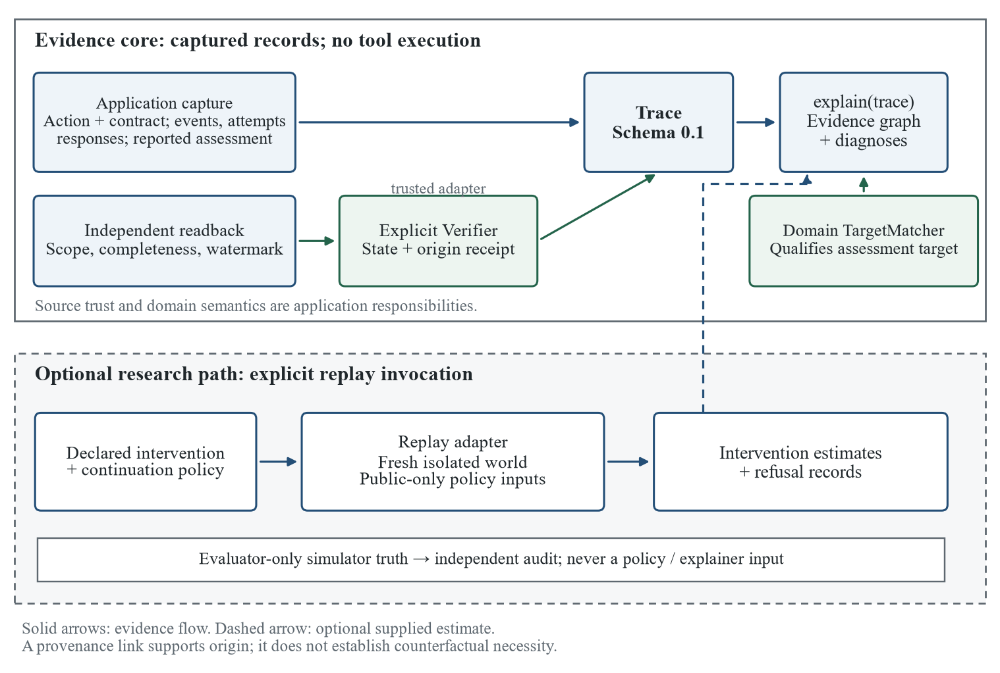
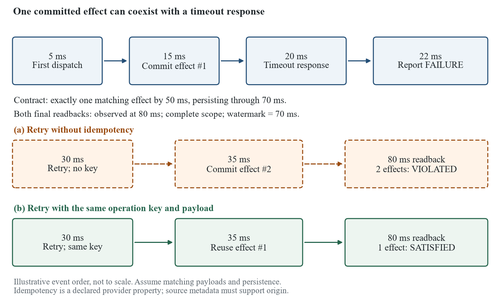
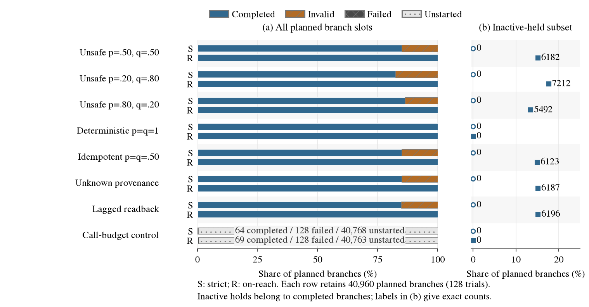
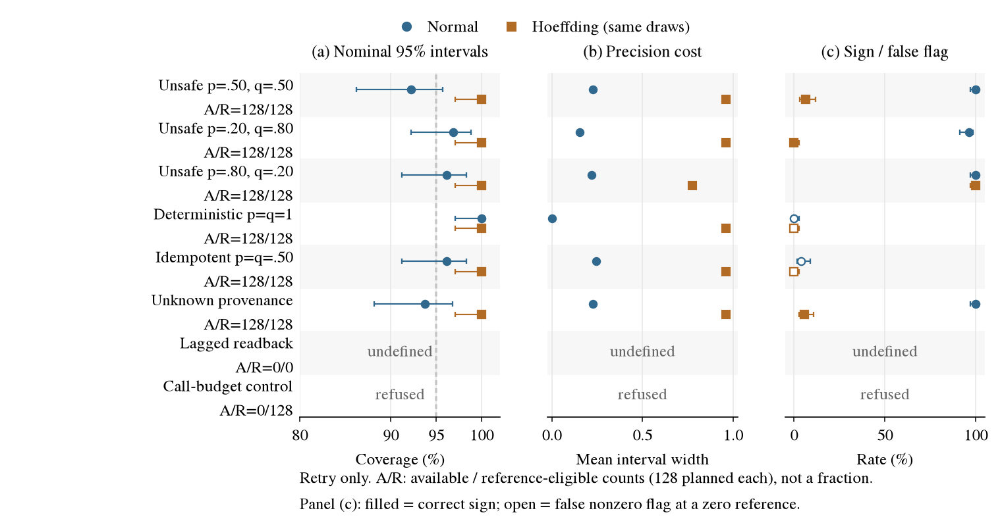

# Consequa-X: An Evidence and Intervention Protocol for Consequential Agent Actions

Devrajsinh Jhala

Complete protocol and software manuscript, updated 16 October 2026. This readable
source follows the [generic IEEE conference version](consequa-x-ieee.tex). No
specific conference, acceptance, institutional affiliation or funding is asserted.
The contribution and empirical claims are limited to the declared artifact and
settings. Broader comparative research is future work.

## Abstract

An agent's selected operation, tool response, reported assessment and external
effect can disagree. A refund may commit before an acknowledgement is lost,
and another actor may satisfy the requested state. Consequa-X records these
distinctions in portable evidence traces, verifies temporal contracts from
independent readback and executes isolated intervention replays with explicit
unknown, invalid and budget-exhausted outcomes. The contribution is a software
and evidence protocol; its contrastive and permutation Shapley estimators adapt
existing methods. Audited synthetic studies retain 1,280 original calibration
trials, 384 fresh shared-draw comparisons and 2,048 repeated physical sampling
trials. Several original nominal 95% intervals undercovered specified effects.
Conservative alternatives retain
uncertainty at homogeneous samples but have substantial precision and
detection costs. Physical refund enumeration shows different initial-action
and consequence interactions under an explicit on-reach positional game.
A separate 24-episode local-model validation found six contradicted status
claims among ten assessable claims for one prompt, while another abstained in
every structured status but retained affirmative language in some rationales.
The reusable core supports explicit application verifiers and separates
successive effect witnesses in its evidence graph. These results establish
auditable implementation behavior and measured limitations in the declared
settings; they do not establish a new estimator or broad attribution superiority.

**Index terms:**
agent systems, outcome verification, evidence provenance, counterfactual replay,
software artifacts, uncertainty

## 1. Introduction

A consequential tool operation has distinct stages: selection, dispatch,
execution, response, reported assessment and external observation. A service
can commit an effect before its acknowledgement is lost. Retrying can create
another effect unless the logical operation's identity and idempotency semantics
are retained. Conversely, a successful response can coexist with an incomplete
or incorrect effect. Explaining such runs requires more than reading the last
tool response or the agent's prose.

State satisfaction and effect origin also differ. An external refund may
satisfy the requested balance or count while remaining unlinked to this agent.
A source-supported origin link is a provenance claim; it does not establish
counterfactual necessity. A replay effect is a separate claim about a declared
intervention, continuation policy and outcome distribution.

Consequa-X makes these distinctions inspectable. Its core contains typed
records, schema validation, application verification and evidence-only
explanation. Its research adapters provide isolated refund worlds, public-only
policy inputs, a local Ollama adapter and bounded replay experiments. Reported
assessments are captured outputs, not measurements of hidden reasoning.

This paper contributes (1) a reproducible protocol linking operation identity,
attempts, responses, assessments, independent readback, conclusions and origin;
(2) replay infrastructure with declared games, actual-call accounting and
complete refusal records; and (3) audited evidence exposing uncertainty and
reporting limits in specified synthetic and exploratory local-model settings.
It presents a protocol/software artifact rather than a superiority comparison.
Figure 1 separates the captured-evidence core from the explicitly invoked
research replay path.

**Figure 1. Evidence flow and trust boundaries.** Application verifiers interpret
independent readback; explanations use captured evidence. Explicitly invoked
replay can supply estimates, while evaluator truth remains audit-only. Source
trust and domain semantics remain application responsibilities.

## 2. Related Work

Causal Agent Replay (CAR) performs same-policy interventions on recorded
decisions, evaluates user-specified outcomes and uses contrastive suffix and
permutation Shapley attribution [Shah, CAR v1](https://arxiv.org/html/2606.08275v1). Consequa-X implements an independent
binary adaptation with its own typed-world, evidence and refusal boundaries.
Applying a verified outcome to replay is therefore not an estimator novelty
claim. Policy-Conditioned Counterfactual Credit studies changes in final
verified success under specified interventions and a continuation
policy [Meng, PCCC v1](https://arxiv.org/html/2606.05263v1); its learning objective differs from post-hoc external-effect
diagnosis, but verified targets and valid interventions are shared concerns.

CausalLoss-Fin jointly intervenes on agent decisions and repairable
infrastructure messages [Sharma, CausalLoss-Fin v1](https://arxiv.org/html/2609.25960v1). Its deterministic programmatic
evaluation limits transfer to stochastic language policies, but it already
occupies the broad combination of financial effects and joint decision/fault
attribution. A future comparison must expose applicable variables to every
method rather than charge omitted infrastructure effects to decisions.

Verified Tool Calls distinguishes acknowledgements from independently checked
effects and uses unknown postcondition conclusions [Mansoor, Phadke and Rana v1](https://arxiv.org/html/2608.02645v1).
Callability Is Not Operability studies controlled interface ambiguity and
terminal agent claims [Wang v2](https://arxiv.org/html/2608.23628v2). Three-valued verification and
response/effect separation are foundations and comparison requirements here.
These targeted primary-source checks do not constitute a systematic review or
an independent reproduction of those papers' empirical results.

## 3. Evidence Protocol and Core Interfaces

### Objects, contracts and trust

Let $H$ be visible history, $A$ a logical action, $E$ an execution attempt,
$R$ its response, $B$ a timestamped reported assessment and $O$ an independent
readback observation. A contract $C$ declares payload, count, deadline and
stability horizon. The verifier conclusion $V(C,O)$ is satisfied, violated or
unknown. Origin is separately confirmed, other actor or unknown. Evaluator-only
simulator truth never becomes a policy or explainer input.

The built-in refund predicate uses integer currency minor units. An eligible
effect matches payment, amount and currency, commits in the declared time
window and persists through the horizon. Exact-count contracts also constrain
the count during the stability interval. A stale watermark or inadequate scope
and completeness yields unknown rather than a confident absence claim.
Source authority, scope, completeness and watermark declarations remain trusted
adapter inputs. Schemas and hashes validate structure and changed bytes, not
source authenticity or real transactional guarantees.
Figure 2 illustrates why a response and a reported assessment cannot substitute
for a horizon-covering outcome observation.

**Figure 2. Illustrative timeout-after-commit sequence.** A committed effect
precedes a timeout and reported failure. An unsafe retry creates a duplicate;
reusing the same provider-scoped idempotency key and payload preserves one effect.
Complete final readback covers the stability horizon. Arrows show event order,
and times are illustrative rather than sampled observations.

### Reusable application boundary

Applications can supply an explicit read-only verifier through
`verify(action, observation, verifier=...)`. The wrapper checks receipt
type, contract identity, observation identity, source, watermark and timing.
Domain predicate semantics, authentication and read-only adapter behavior are
the application's responsibility. There is no evaluation of arbitrary predicate
strings. An offline artifact-delivery example constructs captured records and
checks independently read-back content digests without importing the refund
simulator or executing writes.

`explain(trace)` reads a captured verification and performs no replay.
Refund target matching is built in; other predicates receive a neutral
explanation unless a trusted domain matcher explicitly qualifies attributable
effects against payload and temporal rules. Matchers can return only unique
IDs within the receipt's attributable IDs. Unknown receipts are not interpreted
as target matches. A qualified provenance link still is not a causal effect.

### Successive witnesses and graph meanings

Repeated readbacks can disagree about the same effect identifier. The graph
therefore retains observation-specific witnesses and an identity-only shared
effect node. Dispatch-to-effect edges attach to the witness supplying origin
metadata; verification edges use witnesses in that receipt's own observations.
A later conflicting actor, corrected payload or reversal cannot overwrite an
earlier witness and inherit its unqualified origin link. Shared identifiers do
not authenticate or reconcile the records. Estimated-influence edges require
captured event identifiers and an explicitly supplied intervention estimate.

## 4. Replay Targets, Games and Uncertainty

### Targets and conditional suffix effects

The refund adapter exposes three targets: initial action selection, global
state-contract satisfaction and action-linked consequence. A known global
violation is false for the linked target. Satisfied state with exclusively
external qualifying effects is false for that target; insufficient provenance
can instead yield unknown. The linked target combines global satisfaction and
qualifying operation-linked witnesses rather than reconstructing an agent-only
world. Unknown observations do not acquire numeric labels.

For known binary target $Z$, set bad outcome $X=1-Z$. Prefix replay holds
factual decisions before position $k$ and resamples the suffix. With one
observed factual bad label $x_f$, the conditional estimand is
$$
\gamma_k = \mathbb{E}[X\mid \text{prefix held, suffix resampled at }k]-x_f.
$$
The factual term is one observed constant, not a population rate estimate.
Negative values indicate rescue relative to that observation. An earlier
irrelevant position can have a nonzero suffix effect through a later stochastic
choice. A latest nominal rescue is selected only when every planned position
is estimable and its interval supports a negative effect. This selection has
no simultaneous coverage guarantee and does not establish a unique cause.

### Held-decision coalition games

Let $N$ be reached factual positions. Coalition $S$ requests holding captured
decisions at positions in $S$; other decisions are sampled. Reached held
decisions must match the typed public stage. In the **strict** game, an
earlier termination leaving a requested held position unreachable invalidates
the draw. Finite samples avoiding invalidity do not define the population game.

The separate **on-reach** game treats requested positions beyond a normal
termination as inactive and uses the actual completed episode. Reached
incompatible operations remain invalid; provider failures and exhausted budgets
are not normal inactivity. This is an explicit alternative game, not a repair
of retained strict results.

For a defined game $v(S)=\mathbb{E}[X\mid S]$, signed Shapley values allocate
the held-decision effect [Shapley, RAND P-295](https://www.rand.org/pubs/papers/P295.html):
$$
\phi_i = \sum_{S\subseteq N\setminus\{i\}}
\frac{|S|!(|N|-|S|-1)!}{|N|!}\,[v(S\cup\{i\})-v(S)].
$$
Fresh forward/reverse permutation walks form one paired contribution vector.
Independent empty/full draws diagnose the endpoint scale. Values are signed
allocations under the declared game, not normalized responsibility shares.
Positive values mean holding the factual decision increases bad outcomes;
negative values mean it is protective.

### Intervals and refusals

Contrastive defaults use exact binomial Clopper–Pearson bounds translated by
$-x_f$ [NIST binomial intervals](https://www.itl.nist.gov/div898/handbook/prc/section2/prc241.htm). Signed pair observations lie in $[-1,1]$; the default
Hoeffding half-width for $P$ independent pairs and failure allowance $\alpha$
is [Hoeffding, 1963](https://doi.org/10.1080/01621459.1963.10500830)
$$
h=\sqrt{\frac{2\log(2/\alpha)}{P}}.
$$
This is the half-width before clipping the interval to $[-1,1]$.
Endpoint differences use two exact binomial marginals with a split failure
allowance. Each marginal has confidence $1-\alpha/2$; the difference interval
is $[L_f-U_e,U_f-L_e]$. The union bound requires valid marginal bounds, not
independence between the two arms. Bootstrap and normal intervals remain
explicit legacy comparators.
These are standard conditional methods with sampling assumptions and precision
costs, not distribution-free guarantees for dependent model continuations.

Each replay starts a fresh declared world. Held replies consume no fresh calls;
every attempted fresh call, including a provider/protocol failure, consumes
budget. Every planned branch remains recorded. Unknown, invalid, failed and
unstarted branches are not dropped or redrawn; affected estimates are refused.
Targets and interval variants reuse captured evidence without extra policy calls.

### Analytic refund reference

Consider the declared on-reach refund mechanism with adequate budget, complete
horizon-covering readback and, for the linked target, sufficient provenance.
The planted factual decisions are selection $s$, retry $r$ and final stop $t$.
Fresh selection occurs with probability $p$ and fresh timeout retry with
probability $q$ under the declared independent choice law. The first attempt
commits despite its timeout; without idempotency, a retry commits a second
refund. Exactly one effect therefore occurs with probability $p(1-q)$.
For the consequence bad-outcome game, the four relevant coalition values are

$$
\begin{aligned}
v(\varnothing)&=1-p(1-q), & v(\{s\})&=q,\\
v(\{r\})&=1, & v(\{s,r\})&=1.
\end{aligned}
$$

The final stop is a dummy: adding $t$ changes none of these values. Averaging
the two orders of the active players gives

$$
\begin{aligned}
\phi_s&=-\tfrac12(1-p)(1-q),\\
\phi_r&=\tfrac12(1+p)(1-q),\qquad \phi_t=0.
\end{aligned}
$$

Their sum is the endpoint difference $p(1-q)$; the selection/retry interaction
$v(\{s,r\})-v(\{s\})-v(\{r\})+v(\varnothing)$ is $(1-p)(1-q)$.
At $p=q=0.5$, these are shares $[-0.125,0.375,0]$, endpoint 0.25 and
interaction 0.25. With idempotency, any selected refund creates one effect,
so consequence shares become $[-(1-p),0,0]$, as for initial action selection;
the interaction is zero. These are population references derived from the
declared mechanism, not fitted to sampled outcomes. A call cap can refuse the
finite estimate despite a defined ideal reference. Unknown evidence or strict
unreachable-held decisions do not acquire numeric references from these forms.

A standalone standard-library check uses exact rational arithmetic on a
five-by-five $(p,q)$ grid, two idempotency settings and two targets: 100 control
cases. It checks all coalition values and six permutation orders against these
forms without importing the framework or reading sampled study data. This
checks the stated mathematical law, not simulator execution or sampling validity.

## 5. Audited Evaluation

### Original calibration and finite analysis

The original development study retained 1,280 trials across ten specified
mechanisms, with 128 repetitions. Of 223,232 planned branches, 198,690
completed, 4,062 were invalid, 256 failed at the deliberate cap and 20,224
were unstarted. Standalone audit scripts checked raw evidence, seeded outcomes,
statistics and accounting. Table 1 reports a preselected
protective-stop consequence position with 128 available, reference-eligible
estimates in each row.

**Table 1. Original nominal 95% coverage at the protective stop.**

| Retry $q$ | Contrastive covered | Shapley covered |
| --- | --- | --- |
| 0.1 | 100/128 | 107/128 |
| 0.5 | 122/128 | 121/128 |
| 0.9 | 103/128 | 103/128 |

Separate finite-distribution calculations yielded protective-stop normal pair
coverage of 83.7775% at $q=0.1,0.9$ and 92.6377% at $q=0.5$ for 16 pairs.
For interior Bernoulli $q$, homogeneous draws force an empirical percentile
bootstrap interval to a point, giving coverage ceiling
$1-q^K-(1-q)^K$. At $K=16$ and $q=0.1,0.9$, this is about 81.47%.
These findings concern the specified adaptation; they do not establish
coverage of upstream CAR implementations.

### Shared-draw conservative comparison

A separately frozen follow-up retained 384 trials across twelve cases,
66,048 planned branches and 87,054 actual scripted calls. Variants reused
the same points, draws, seeds and refusals. Exact probability weights over
sample counts 8,16,32,64 and eleven probabilities yielded minimum grid
coverage 7.72% for the limiting empirical percentile bootstrap, 85.15% for
Wilson and 96.68% for Clopper–Pearson. The bootstrap grid is its
infinite-resample limit, distinct from the replay's finite seeded bootstrap.

**Table 2. Fresh shared-draw coverage: 32 trials per row.**

| $q$ | Bootstrap | Exact binomial | Normal | Hoeffding |
| --- | --- | --- | --- | --- |
| 0.1 | 26/32 | 31/32 | 23/32 | 32/32 |
| 0.5 | 31/32 | 32/32 | 32/32 | 32/32 |
| 0.9 | 31/32 | 32/32 | 29/32 | 32/32 |

Table 2 is the protective-stop timeout position, not every
case. The full summary includes exact-binomial coverage 30/32 for a retry-pivot
case. Finite observed coverage can fall below nominal despite a conservative
population method. At $q=0.1$, mean normal versus Hoeffding width was about
0.180 versus 1.358; at $q=0.5$, 0.344 versus 1.184. Hoeffding detected the
negative reference sign in 0/32 trials at both weaker settings, and 32/32 at
$q=0.9$. Wider intervals therefore impose a substantial detection cost.

The hardened independent audit passed 3,283,523 assertions at its recorded
derived-artifact inventory; twenty targeted corruptions were rejected. A
separate SciPy numerical audit covered 1,290 binomial cases and 1,290 endpoint
differences, with maximum binomial endpoint disagreement approximately
$2.66\times10^{-14}$. SciPy was an audit dependency, not a framework runtime
dependency. Finite grids and synthetic replays do not establish live-model
sampling independence or simultaneous attribution coverage.

### Physical interactions and variable length

An independent physical enumeration covered four deterministic fresh-choice
components, eight held masks, two games and eight cases, retaining 512 planned
branches and 718 actual scripted calls. Outcomes came from ordinary payment
readback rather than injected payoff values. With selection and timeout retry
probabilities $p=q=0.5$, unsafe retry and exactly-one verification, on-reach
consequence shares were $[-0.125,0.375,0]$, with selection/retry interaction
0.25. Action-selection shares were $[-0.5,0,0]$. Idempotency changed consequence
shares to $[-0.5,0,0]$ and removed the interaction. This is a declared
programmatic mixture, not observed model interaction recovery.

The strict population game remained undefined at interior probabilities;
missing provenance, lag and small budgets retained their distinct limits.
The independent audit passed 27,277 checks; twenty-nine semantic corruptions
were rejected. The original export manifest and data remain preserved alongside
the derived canonical inventory. Two sampler integration controls exercised
32 pairs and 32 endpoint draws, with eighteen coefficients within a broad
0.3 regression tolerance. That tolerance alone is not a calibration result.

### Repeated physical sampling

A separately frozen protocol exercised the actual permutation sampler across
all eight declared physical mechanisms, both games and 128 fresh repetitions
per mechanism/game: 2,048 trials. Each trial planted the same three factual
decisions and used 32 forward/reverse permutation pairs, one draw per coalition
evaluation and 32 independent draws per endpoint, yielding 320 planned branches.
The planted factual path was specified rather than selected by seed search.
The cap was 1,000 actual calls including three factual calls, except for the
four-call budget control. Collection used normal intervals; Hoeffding and
exact-binomial endpoint differences were rescored from identical draws without
additional calls, altered points or redrawn refusals. The installed checkpoint,
precollection protocol, all compressed trial/branch rows and replicate-zero
full evidence with separately stored evaluator truth are retained.

The run retained all 655,360 branches: 536,150 completed, 37,423 invalid,
256 failed and 81,531 unstarted. It consumed 628,535 scripted calls, including
6,144 factual calls, and zero language-model calls. On-reach execution recorded
37,392 branches with inactive requested holds; these are normal-termination
records, distinct from strict invalidity and budget exhaustion.
Figure 3 retains both games and every branch status, displaying inactive holds
separately from the mutually exclusive status partition.

**Figure 3. Disposition of all planned branches across eight mechanisms and two
games: 40,960 slots per row.** Completed execution includes unknown target
evidence and known violations; it does not establish an available coefficient.
Failed and unstarted budget-control slots remain visible through exact counts.
Inactive holds are a subset of completed branches, shown separately.

A standalone auditor importing no framework implementation passed 44,698,925
assertions over the retained trials, branches, 4,210 complete traces and all
summary rows. Its receipt binds the frozen source revision and original
52-file manifest. Derived tables retain every row separately from that sealed
collection; auditing made no generation calls.

**Table 3. All eight declared cases: on-reach retry coefficient for global
consequence, 128 planned repetitions per row.** N/H denotes normal/Hoeffding.
Availability A and population-reference eligibility R each have denominator 128.
Flags denote correct directional detection for nonzero references and false
nonzero flags for zero references. Dashes denote undefined quantities;
0/0 denotes an undefined coverage rate.

| Case $(p,q)$ or control | Reference | A ; R | Covered N / H | Mean width N / H | Flags N / H |
| --- | --- | --- | --- | --- | --- |
| Unsafe $(0.5,0.5)$ | 0.375 | 128 ; 128 | 118/128 ; 128/128 | 0.226 / 0.960 | 128/128 ; 8/128 |
| Unsafe $(0.2,0.8)$ | 0.120 | 128 ; 128 | 124/128 ; 128/128 | 0.154 / 0.960 | 123/128 ; 0/128 |
| Unsafe $(0.8,0.2)$ | 0.720 | 128 ; 128 | 123/128 ; 128/128 | 0.218 / 0.773 | 128/128 ; 128/128 |
| Deterministic $(1,1)$ | 0 | 128 ; 128 | 128/128 ; 128/128 | 0 / 0.960 | 0/128 ; 0/128 |
| Idempotent $(0.5,0.5)$ | 0 | 128 ; 128 | 123/128 ; 128/128 | 0.244 / 0.960 | 5/128 ; 0/128 |
| No provenance $(0.5,0.5)$ | 0.375 | 128 ; 128 | 120/128 ; 128/128 | 0.228 / 0.960 | 128/128 ; 7/128 |
| Lagged readback $(0.5,0.5)$ | --- | 0 ; 0 | 0/0 ; 0/0 | --- | --- |
| Four-call cap $(0.5,0.5)$ | 0.375 | 0 ; 128 | 0/0 ; 0/0 | --- | --- |

**Figure 4. On-reach global-consequence retry coefficient for all eight cases,
using identical draws for both interval methods.** A/R denotes available and
population-reference-eligible counts, each from 128 planned trials. Coverage and
flag whiskers are 95% Wilson uncertainty for repeated-trial rates, not coefficient
intervals. Filled flag markers indicate correct directional detection; open
markers indicate false nonzero flags for zero-reference controls. Undefined
evidence and budget refusals have no zero-valued markers.

Table 3 reports every declared mechanism for one specified target and position,
including unavailable controls. Figure 4 places coverage beside interval width
and detection to expose their tradeoff without pooling targets or cases.
At $(p,q)=(0.5,0.5)$, the shared retry estimate
had bias $-0.00269$ and RMSE 0.0611. Normal coverage 118/128 has a 95% Wilson
interval $[0.862,0.957]$; 128/128 has $[0.971,1]$, not proof of perfect
population coverage. The conservative intervals sharply reduced weak-effect
sign detection. For the consequence stop dummy, normal false nonzero flags
ranged from 0 to 14/128 across the six assessable mechanisms; Hoeffding flags
were 0/128 in each. The deterministic zero-reference case yielded 128 normal
point intervals; their correctness in that case does not validate point intervals
for stochastic outcomes.

Endpoint behavior was separately assessed. For the on-reach unsafe
$(0.2,0.8)$ global-consequence endpoint,
normal coverage was 92/128 (Wilson $[0.635,0.789]$), with 35 point intervals
and mean width 0.114. Exact-marginal differences covered 128/128, with mean
width 0.319. These finite results demonstrate the declared precision tradeoff;
they do not establish simultaneous coverage or calibration under live-model
dependence.

In the on-reach game, every lagged-consequence coefficient was refused as
unknown; every budget
coefficient was refused after unstarted slots, despite the latter's defined
ideal reference. Removing provenance preserved global-consequence availability
but refused all 128 linked-consequence coefficient vectors. All nondeterministic
strict coefficient vectors were unavailable and their population games undefined;
the fully deterministic strict control remained defined. One finite strict
interaction point at $(0.8,0.2)$ did not make that population interaction
defined. One strict linked-consequence endpoint without provenance was numeric
but reference-ineligible, giving coverage 0/0 rather than an accuracy result.
Pooled-coalition interaction diagnostics have no confidence interval
and supply no coverage or sign-detection result. The full summary retains
separate availability, reference eligibility, bias/RMSE, coverage uncertainty,
width, flags, endpoints, interactions and refusal rows for every target,
position, game and interval variant. Reused targets and variants are not
independent replications.

### Exploratory local-model validation

A frozen installed Qwen3 4B checkpoint completed six validation cases,
two repetitions and two unchanged prompt profiles, using 59 actual calls
within a 72-call cap. No episode failed or remained unstarted. Model identity,
prompt/payload hashes, public traces and the exact source checkpoint are retained.
The original and revised profiles induced different action sequences; this
is not a pure reporting experiment or an attribution-method comparison.

**Table 4. Local-model validation with explicit claim denominators.**

| Quantity | Original v1 | Revised v2 |
| --- | --- | --- |
| Completed/planned episodes | 12/12 | 12/12 |
| Actual calls/profile cap | 36/36 | 23/36 |
| Definite final status claims | 12/12 | 0/12 |
| Contradictions/assessable claims | 6/10 | 0/0 |
| State satisfied/violated/unknown | 6/4/2 | 7/3/2 |
| Linked satisfied/false/unknown | 6/4/2 | 5/5/2 |

The revised profile's conditional contradiction rate is undefined, not zero
error. In the other-actor case, revised-profile readback satisfied state while
origin was external and action linkage false. In the expired-request case,
the original profile correctly described ineligibility but issued a refund;
its failure assessment contradicted achieved effect. Effect satisfaction and
eligibility-policy correctness are distinct targets.

A separate unblinded annotation pass within the AI-assisted development
workflow marked affirmative processing clauses in 10/12 original and 7/12
revised final rationales. Five of those
seven revised rationales also hedged independent verification. A statement
that a second attempt committed can be literally true while two effects
violate an exactly-one task. These annotations are descriptive; no independent
human verification or inter-rater reliability has been established. Unknown
structured fields do not ensure prose abstention. The saved auditor passed
2,227 assertions and rejected seven
corrupted smoke copies without additional generation. Fixed profile order,
tiny sample size, shared fault conditions and an exposed validation family
limit interpretation. The held-out reserve was not generated.

## 6. Discussion and Limitations

The evidence protocol supports different, inspectable claims about responses,
state, origin and intervention effects. Its refusal rules prevent unsupported
numerical outputs but can sharply reduce availability. Availability can depend
on interventions and must remain visible beside numerical results. Conservative
intervals do not make undefined games numeric, resolve missing evidence, or
remove the need to assess the actual sampling law.

The environment is synthetic and narrow. The artifact-delivery example validates
an integration interface, not a second production-domain experiment. Declared
source authority and watermarks are not authenticated transactional guarantees.
The model experiments use one local model and exposed development/validation
families; they do not estimate broad model performance or held-out transfer.
State and linked targets sharing outcomes are not independent replications.
Claims about hidden reasoning cannot be inferred from reported assessments.

Future superiority research requires faithful modular baselines with matched
evidence, target definitions, candidate variables, snapshots and actual budgets.
Joint context/fault attribution must expose infrastructure variables. Independent
template and fault-composition families, predeclared precision, replay-fidelity
checks and cluster-aware uncertainty are needed for generalization claims.
Those comparisons are future work, not completed evidence of this paper.

## 7. Conclusion and Artifact Availability

Consequa-X provides a reusable evidence core and auditable replay adapters for
separating reported assessments, external outcomes, origin and intervention
effects. The retained studies expose uncertainty failure, precision costs,
variable-length game restrictions and prose/structured-status disagreement.
The useful result is a reproducible protocol/software artifact with measured
limits, without claiming a new estimator or general method superiority.

Stable version 1.0.0 is publicly available under MIT on
[PyPI](https://pypi.org/project/consequa-x/1.0.0/). Its wheel and source
distribution were independently downloaded and hash-checked, and an isolated
registry installation was verified on October 15, 2026. The wheel contains the runtime, schemas and typing
marker; the source distribution also includes documentation, offline examples,
tests and audit scripts. Private research outputs and model weights are excluded.
The maintainer-controlled
[repository](https://github.com/Devrajsinh-Jhala/consequa-x) is private. Git
history, retained protocols, raw evidence and evaluator-only truth are retained
there for authorized collaborators; this paper does not assert unrestricted
access to that research archive.
Each historical study retains its own source revision and manifest; later
engineering fixes do not silently replace earlier data. A public immutable
research archive and review-access arrangements have not been established.
Framework imports and offline examples require no model credentials or required
runtime dependencies. All reported payments are simulated; model weights are
identified rather than redistributed.

## Acknowledgment

Generative AI assistance was used for software development, research-source
inspection, rationale annotation and manuscript drafting. The empirical records
and audit scripts are retained for review. Final human checking of annotations,
manuscript, code, references and submission requirements remains required before
submission and is the authors' responsibility.

## Evidence and reproducibility links

The [evidence ledger](evidence-ledger.md) maps claims to retained artifacts and
frozen source revisions. The [source audit](source-audit.md) records the focused
primary-source inspection and access limits. Bibliographic metadata is retained
in [references.bib](references.bib). These files are available within the
maintainer-controlled repository; links do not imply public research-archive access.

- [Original calibration](../output/calibration-probe-2026-10-11/FINDINGS.md) and
  [finite analysis](../output/calibration-theory-2026-10-11/README.md).
- [Shared-draw interval comparison](../output/interval-comparison-2026-10-13/FINDINGS.md).
- [Physical refund enumeration](../output/refund-interactions-2026-10-13/README.md)
  and [independent audit](../output/refund-interaction-audits-2026-10-13/independent.json).
- [Repeated physical sampling protocol](../output/interaction-sampling-2026-10-15/protocol.json),
  [all summary rows](../output/interaction-sampling-2026-10-15/summary.json),
  [execution receipt](../output/interaction-sampling-2026-10-15-execution.json) and
  [frozen installed checkpoint](../output/interaction-sampling-checkpoint-2026-10-15/checkpoint.json).
- [Repeated-sampling independent audit](../output/interaction-sampling-audits-2026-10-15/independent.json),
  [derived findings](../output/interaction-sampling-findings-2026-10-15/FINDINGS.md),
  [full analysis](../output/interaction-sampling-findings-2026-10-15/analysis.json),
  [all coefficient rows](../output/interaction-sampling-findings-2026-10-15/coefficients.csv),
  [endpoint rows](../output/interaction-sampling-findings-2026-10-15/endpoints.csv) and
  [interaction rows](../output/interaction-sampling-findings-2026-10-15/interactions.csv).
- [Local-model validation](../output/local-validation-2026-10-14/FINDINGS.md) and
  [frozen proposal](protocol-next-validation.md).
- [Application integration](../docs/application-integration.md) and
  [graph witnesses](../docs/graph-witnesses.md).
- [Broader study plan](../docs/study-plan.md) and
  [CAR reproduction plan](../docs/car-reproduction-plan.md).
